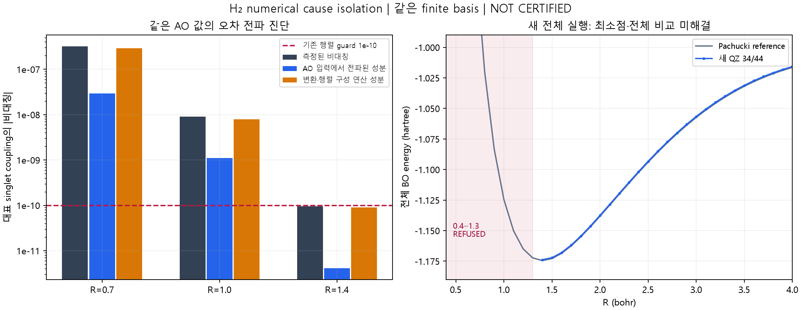

# H₂ same-finite-basis numerical refusal 원인 분리 V1

2026-10-02. **NUMERICAL CAUSE IDENTIFIED(조사한 경로·대표 coupling 범위) /
SAME-FINITE-BASIS EQUIVALENCE(해석적 구조·표본 수치 확인) /
QZ CURVE INCOMPLETE / 부분 PHYSICAL COMPARISON / NOT CERTIFIED.**

## 1. 먼저 공개하는 결과와 미해결

기존 누락 16점의 실패를 archived source 그대로 재현했다.
좌표변환만 바꾸어 QZ R=1.4는 기존 tolerance로 계산할 수 있었지만,
QZ 0.4–1.3은 세 binary64 좌표 경로에서 여전히 거부됐다.
선택을 봉인한 뒤 QZ **44점을 전부 처음부터** 실행했고 **34 accepted / 10 refused**다.
빠진 점만 채우거나 원래 QZ 값과 섞지 않았다.

대표 QZ 0.7/1.0에서는 (a) AO 입력 자체의 미세한 비대칭이 좌표변환으로 증폭되는 성분과
(b) binary64 변환·CI 행렬 구성의 연산 오차를 분리했다. 더 정확한 Cholesky 계수만으로
(a)는 사라지지 않는다. 이는 canonical S^-1/2 하나만의 결함이나 H₂ 부재로 분류할 수 없다.
모든 binary64 좌표변환의 불가능성 또는 libcint 전체의 결함을 증명한 것도 아니다.

가장 낮은 계산값은 support의 왼쪽 끝 **R=1.4**다. R=1.3이 없으므로 원래 P1의
양쪽 이웃 bracket을 만들 수 없다. **sampled minimum 위치·깊이는 UNRESOLVED**다.
34점의 외부 max difference가 0.001 hartree 아래여도 전체 44점 PASS가 아니다.
H₂ formation/dynamics·새 physics/basis·production/world 통합·foundation 승격은 없다.

## 2. Git / 범위 / 원본 보존

시작 master, HEAD=local origin/master=`164ecdeb2dac13bbee7f829596a5d40c43f0b64e`,
ahead/behind 0/0, dirty 0. fetch 없음. 이번 요청은 push 금지이며 이전 commit 허용 지시가 유지된다.
관련 직전 commit은 isolated H₂ pilot, 그 앞은 `f7c2c8d` Drude 비교 후보다.

AGENTS/RULES 전체와 CURRENT_STATE/REPO_MAP의 활성 상태·연구 경로·검증 경계,
기존 pilot 사양/결과/소스를 확인했다. CURRENT_STATE의 긴 C1-B1 역사와 REPO_MAP의
무관한 목록은 부분 확인이며 저장소 전체 감사·runs 전체 탐색은 하지 않았다.
기존 [pilot V1](H2_STATIC_REFERENCE_PILOT_V1.md)과 Git compact evidence,
기존 실행 코드·protocol·reference CSV를 수정하지 않았다.
추가 구현은 `electronic_pilot/numerical_cause/`, 신규 시험과 문서다.

실행 전 stage마다 protocol/source/basis/version/기존 보호 대상 hash를 별도 봉인했다.
원본 `runs/h2_static_pilot_v2/full/` JSON **149개**, 기존 source/compact evidence **27개**의
SHA-256 불변을 새로 확인했다. 새 accepted QZ NPZ 34개도 기록된 artifact hash와 대조했다.
원래 matrix NPZ 전체를 재감사했다고 주장하지 않는다. 파일을 덮어쓰는 실험은 하지 않았다.

## 3. 변하지 않은 물리 / 좌표변환의 동등성

fixed-nuclei, isolated nonrelativistic Coulomb, 전자 2, full spatial singlet,
standard spherical contracted cc-pVDZ/VTZ/VQZ, PySCF 2.12.1/libcint AO integrals.
`EBO=Ee+1/R`이며 nuclear repulsion을 한 번 더한다.
원래 overlap floor 1e-10, orthogonality operator norm 1e-10,
singlet max asymmetry 1e-10, eigen residual 1e-9, vector norm error 1e-10을 유지했다.
floor는 전체 입력 거부 guard이며 작은 eigenvector를 삭제하는 cutoff가 아니다.
이번 spectra의 Smin은 모두 floor 위다.

| 경로 | 전체 M개 orbital을 만드는 방법 | 의미 |
|---|---|---|
| A symmetric | C=U diag(s^-1/2) Uᵀ | 기존 symmetric S^-1/2 |
| B Cholesky | S=LLᵀ, C=L^-T | triangular inverse, AO 삭제 없음 |
| C generalized h | h C=S C ε의 모든 M generalized eigenvectors | 점유 orbital만 남기지 않음, 모든 root 보존 |

정확한 symmetric positive-definite S에서 두 full orthonormal C 사이의
`U=C_Aᵀ S C_B`는 orthogonal이고 `C_B=C_A U`다.
전체 symmetric two-electron product space의 좌표변환은 `Pᵀ(U⊗U)P`로 orthogonal이며
두 singlet Hamiltonian은 congruence/similarity 관계다. full dimension M(M+1)/2,
모든 에너지와 sector를 보존한다. 이것은 basis/physical approximation 추가가 아니다.
수치 AO 배열은 미세하게 비대칭이므로 이 정확 항등식을 비트 동일성 인증으로 쓰지 않는다.

기존 accepted controls 10개(DZ 0.4/1.4/2/20, TZ 1.4/2/20, QZ 1.5/2/20)를 먼저 실행했다.
3 coordinates × 2 transformation backends = **60 accepted**, 원래 source와 energy 차이
최대 **2.349676e-12 hartree**(사전 same-problem 기준 1e-9).
control coordinate map의 orthogonality 오차 최대 1.03443e-12,
reconstruction relative norm 최대 3.15529e-13. 이들은 표본 검증이며 전체-domain 인증은 아니다.
새 곡선과 이전 accepted QZ가 겹치는 33점의 energy 차이 최대 8.437695e-13이다.

backend도 분리했다. 원래 `ao2mo.kernel(mol,C)`는 outcore이며 AO를 내부에서 재생성한다.
`common_ao_incore`는 한 번 저장한 uncompressed `int2e, aosym=s1` ndarray를
세 좌표 경로 모두에 **동일 바이트로** 전달한다. 어느 tensor도 평균/보정하지 않는다.
outcore row의 AO digest는 진단 snapshot의 hash이며 내부 packed buffer와의 비트 동일성
주장이 아니다. [PySCF transformation 사양](https://pyscf.org/contributor/ao2mo_developer.html),
[generalized eigenvector 사양](https://docs.scipy.org/doc/scipy/reference/generated/scipy.linalg.eigh.html).

## 4. 기존 실패 재현과 경로 비교

[reproduce_results.json](h2_numerical_cause_v1/reproduce_results.json)에 16점 전체의
overlap spectrum, Smin/condition, ||CᵀSC−I||₂, transformed h symmetry,
ERI ij/kl/pair permutation diagnostics, final singlet asymmetry, first failure stage,
archived-source exception/traceback을 보존했다. 이전 3 NameError도 그대로 재현했다.
진단은 뒤 단계 값을 관측하되 guard 실패 행렬에서 energy를 계산·인정하지 않는다.

| 원래 A/outcore 대표점 | Smin | condition | orthogonality | singlet max asymmetry | 첫 실패 |
|---|---:|---:|---:|---:|---|
| TZ R=0.4 | 9.07e-5 | 4.96e4 | 1.91e-12 | 2.12e-9 | Hermiticity |
| QZ R=0.4 | 5.50e-7 | 9.84e6 | 1.69e-9 | 1.31e-4 | orthogonality |
| QZ R=0.7 | 8.72e-6 | 6.14e5 | 2.89e-11 | 1.98e-7 | Hermiticity |
| QZ R=1.0 | 6.15e-5 | 8.56e4 | 8.46e-12 | 4.93e-9 | Hermiticity |
| QZ R=1.4 | 3.22e-4 | 1.58e4 | 1.66e-12 | 1.83e-10 | Hermiticity |

TZ 0.4–0.8 / QZ 0.7–1.4의 13점은 orthogonality를 통과한 뒤 Hermiticity에서 거부됐다.
QZ 0.4/0.5/0.6의 3점은 orthogonality가 먼저 실패했다.
[compare_results.json](h2_numerical_cause_v1/compare_results.json)의 세 경로/두 backend
96개 진단에서 통과한 원래 누락점은 QZ R=1.4 하나다.

| QZ R=1.4 경로 | outcore asymmetry | common-AO incore asymmetry |
|---|---:|---:|
| symmetric | 1.82682e-10, REFUSED | 1.56373e-10, REFUSED |
| Cholesky | 1.23605e-10, REFUSED | 9.46468e-11, accepted |
| generalized h | 7.77184e-11, accepted | 8.80476e-11, accepted |

세 accepted energy는 −1.17379579224959 hartree 근방에서 6.7e-15 이내다.
Cholesky incore는 orthogonality 2.12147e-13이며 full M=60/D=1830을 유지했다.
기준 통과가 여유가 크다는 뜻은 아니다. 다른 경로들도 R=0.7/1.0에서는 모두 거부됐다.

## 5. 조건부 고정밀 원인 분리

QZ R=0.7/1.0의 여섯 binary64 조합 모두 실패해 사전 HP 조건을 만족했다.
R=1.4는 통과 경계의 비교용 control이다. **60/80 decimal-digit linear algebra 및
231/297-bit MPFR 수축**을 적용하되, worst Cholesky/common-AO singlet coupling만 조사했다.
모든 nonzero coefficient를 유지했다. full HP tensor/CI diagonalization/curve는 하지 않았다.

같은 binary64 C와 raw AO를 고정하고, AO의 antisymmetric component가 해당 coupling에
전파되는 값을 MPFR로 계산했다. 그 값과 실제 binary64 coupling asymmetry의 차이가
변환·행렬 구성·normalization의 잔여 연산 성분이다. diagnostic antisymmetric tensor를
world Hamiltonian으로 사용하거나 원래 값을 보정하지 않았다.

| 대표 coupling | 실제 binary64 비대칭 절댓값 | 같은 AO에서 전파된 성분 | 잔여 변환·행렬 구성 성분 |
|---|---:|---:|---:|
| QZ R=0.7 | 3.22241e-7 | 2.95671e-8 | 2.92674e-7 |
| QZ R=1.0 | 9.07334e-9 | 1.10276e-9 | 7.97058e-9 |
| QZ R=1.4 | 9.46468e-11 | 4.07697e-12 | 9.05698e-11 |

이 세 coupling에서는 성분 부호가 같아 절댓값 합으로 나타나지만 일반적인 오차 예산에서
항상 그렇게 더할 수 있다는 주장이 아니다. 이것은 full matrix norm bound도 아니다.
R=0.7의 AO 성분 중 h contribution은 8.27e-13이고 대부분 ERI contribution이다.

높은 정밀도의 Cholesky 계수로 바꾸어도 AO 성분 변화는 각각 8.74e-20 / 1.38e-21 /
8.14e-25에 그친다. 60→80자리의 변화는 1.83e-64 / 1.65e-66 / 1.47e-70이다.
따라서 이 coupling에서 큰 잔여 오차를 단지 부정확한 C 계수 탓으로 돌릴 수 없다.
0.7/1.0에서는 raw AO 전파 성분 자체도 기존 1e-10을 초과한다.
R=1.4에서는 AO 성분이 작고 표현/연산 경로에 따른 차이가 guard 양쪽으로 갈린다.

raw AO overlap도 max asymmetry 5.00e-16 / 3.61e-16 / 6.66e-16을 갖는다.
invertible C에 대해 `Cᵀ(S−Sᵀ)C`가 남으므로 raw nonsymmetric S를 정확히 I로
congruence-whitening하는 것은 불가능하다. HP도 기존 SciPy처럼 lower triangle으로
Cholesky recurrence를 수행하고 **수정하지 않은 전체 S**로 검증했다.
raw S에 대한 HP orthogonality Frobenius upper bound는 2.29e-12 / 6.50e-13 / 1.17e-13이다.
이 값은 원래 operator norm보다 크거나 같은 상한이며 같은 norm의 직접 비교는 아니다.
S/h/ERI/H에 평균 대칭화 또는 threshold 변경을 하지 않았다.

**고정밀 linear algebra는 libcint binary64 AO integral을 고정밀 integral로 만들지 않는다.**
AO symmetry discrepancy는 내부적으로 정확해야 하는 permutation identity의 오차 증거지만,
AO 모든 entry의 physical accuracy 상한이나 libcint 알고리즘 내부 원인까지 알려주지는 않는다.
고정밀 AO generator·전체 HP 변환·모든 경로의 full spectrum 분해는 미실행이다.

## 6. 네 원인 후보의 판정

| 질문 | evidence 기반 판정 |
|---|---|
| 기존 symmetric S^-1/2 conditioning 문제인가 | QZ 0.4–0.6의 첫 거부에 관여. R=1.4는 좌표 경로에 따라 pass/refuse. 그러나 대표 0.7/1.0의 AO 전파 성분은 HP C에서도 유지되므로 단독 원인은 아님 |
| AO integral transformation 문제인가 | 동일 AO/동일 C의 정확한 진단 수축과 binary64 변환·CI 구성 사이에 큰 추가 연산 성분을 측정. outcore/incore 차이도 기록. 정확히 어느 내부 BLAS/libcint instruction이 원인인지는 미분리 |
| finite basis 자체의 문제인가 | M/D가 유지되고 nonsingular coordinate maps/통과 control energies가 일치. truncated basis 때문에 H₂ minimum이 사라졌다는 증거 없음. 가까운 중심의 AO near-dependence는 condition을 키우는 원인이고, 물리적 basis error와 구분 |
| 더 깊은 binary64 한계인가 | binary64 AO 자체의 대칭 오차가 조건 나쁜 좌표에서 guard 이상으로 증폭되는 대표 사례 확인. 모든 가능한 안정 알고리즘/좌표에 대한 불가능성 증명은 아님 |

## 7. 선택 봉인 뒤 새 44-point QZ와 물리 비교

사전 규칙: 기존 control energy/dimension을 유지한 후보 중 누락점 통과 수가 큰 후보,
동률이면 Cholesky→generalized h→symmetric, backend 동률은 original outcore 우선.
[selection.json](h2_numerical_cause_v1/selection.json)에 **Cholesky/common-AO incore**를
44-point 실행 전에 봉인했다. 원래 grid/criteria/reference는 그대로다.

44/44 attempted, **34 accepted / 10 refused**: R=0.5는 orthogonality,
0.4/0.6–1.3은 Hermiticity. accepted residual 최대 1.56120e-13 hartree.
낮은 계산값 R=1.4, Ee=−1.888081506535302, ENN=0.714285714285714,
EBO=−1.1737957922495874. ENN은 한 번만 포함했다.

[기존 independent checker의 새 기록 비교](h2_numerical_cause_v1/physical_comparison.json)는
QZ-only record view이며 DZ/TZ를 다시 실행하거나 오래된 QZ energy를 삽입한 것이 아니다.
[Pachucki v2](https://arxiv.org/pdf/1007.0322v2)와 동일 target/basis error를 비교한다.
전사/reference uncertainty는 이전 검증을 유지하며 새 physical-reference 계산을 재현하지 않았다.

- **P1:** UNRESOLVED. R=1.4는 available support 끝점이므로 sampled minimum 아님.
- **P3 전체 curve:** INCOMPLETE/NOT PASSED. 34점 max difference **0.000762524510**
  hartree at R=3.3, RMS 0.000626277919. supported subset만 원래 0.001 이내.
- **minimum 위치·깊이 비교:** UNRESOLVED/null. R=1.4의 같은-R point error
  0.000679921971을 minimum error나 dissociation depth 통과로 승격하지 않는다.
- **P2:** 새 isolated H/ghost 5개 계산. 2EH_QZ=−0.9998911371659767,
  R=10/12/16/20의 차이 절댓값 감소, E20−2EH=−5.631403384e-8 ≤1e-6.
  2EH 자체의 정확한 −1 대비 basis error 0.000108862834도 그대로다.

## 8. 시험 / 비용 / 실패 기록 / 구상 대조

Windows 최종 **43 passed, 0.86초**: 신규 18 + 이전 pilot 22 + body freeze 3.
WSL 최종 **49 passed, 3.39초**: 동일 신규18/이전22 + 기존 integration5 + 신규integration4.
failure/error/실제 skip 모두 0. 중복 시험을 더해 unique 수로 세지 않는다.
시험은 full-spectrum synthetic coordinate congruence, full dimension 유지,
overlap/orth/h/ERI fault refusal, AO digest/energy/dimension 선택 변조, incomplete control,
refused row·RSS adapter, MP scalar contraction의 별도 full tensor 구현 대조,
raw asymmetric S 잔여 검사, 실제 DZ 세 경로 동등성이다.
새 결함 주입은 [검증 교훈](../reference/VERIFICATION_LIMITS_AND_LESSONS.md)에 별도 기록한다.

**LOCAL FULL 생략 / 관련 시험으로 대체 / 이유:** 새 독립 진단·시험·문서만 추가,
기존 executable/common/frozen source·contract·fixture 불변, 기존 소스/증거 hash 확인.
공식 통합 Gate 종료나 기준선 갱신이 아니며 공식 LOCAL FULL 숫자를 바꾸지 않는다.

로컬 WSL Ubuntu/Python 3.12.3, PySCF 2.12.1, NumPy 2.5.3, SciPy 1.18.1,
mpmath1.3.0/gmpy2 2.2.2 추가, numerical threads 1, fresh worker/거리 순차 실행.
원격/Vast/GPU 사용 0. 완료 stage wall 합 **288.599초**:
controls34.485 + reproduce33.058 + compare79.988 + QZ121.838 + HP19.230.
환경/문서/시험·초기 실패·원자 진단을 포함한 총 작업 시간은 아니다.
QZ accepted solve 합77.212초, fresh worker 최대 RSS **514.60 MiB**,
전체 진단 stage 최대569.89 MiB. full uncompressed AO tensor를 함께 저장해 기존 pilot보다 메모리가 늘었다.
direct diagonalization이므로 iteration_count=null, iterative convergence 횟수를 만들지 않았다.

첫 MP unit test는 numpy.int64/gmpy2.sqrt 타입 오류로 1 failed/2 passed;
첫 HP worker는 raw asymmetric S를 exact-Hermitian이라고 할 수 없어 STOP했다.
실패 로그·seal을 보존했고 첫 HP 소스는 repair diff로 복원한 뒤 **실행 전 hash와 일치**를 확인했다.
후속 lower-triangle recurrence는 원래 LAPACK 의미를 따르되 full raw S residual을 공개한다.
physical checker view의 RSS 누락 KeyError도 별도 실패 folder/log에 보존하고,
adapter만 고친 뒤 같은 새 곡선을 비교했다. 실패 실행을 PASS/완성 곡선으로 세지 않았다.

개념 2차 대조(작성자 코드/입력 검토, 독립 agent 승인 아님): full AO/singlet dimension 유지,
전자 law/basis coefficients/sector/grid/threshold 불변, reference는 checker 전용,
MP antisymmetric contraction은 diagnostic 전용, guard 거부 energy를 이용한 최소점 판정 없음.
input-known equilibrium/bond/reaction rule·행렬 평균 대칭화·basis 삭제·production 통합은 없다.

## 9. 종료 범위와 남은 선택

**이번 조사 경로의 failure stage 및 대표 coupling 원인은 분류 완료**다.
SAME-FINITE-BASIS는 정확한 좌표변환 구조와 numerical controls로 지지되며 형식 인증은 아니다.
**QZ 44-point curve / minimum / depth / full physical comparison은 UNRESOLVED**다.
현재 고정된 binary64 AO backend와 세 좌표 경로만으로 누락을 제거하지 못한 결과를 보존한다.

후속에서는 같은 physical law/basis에서 더 정확한 AO arithmetic가 가능한지,
또는 AO roundoff의 forward-error를 제어하는 변환 알고리즘이 있는지를 따로 판단해야 한다.
이번 자료만으로 tolerance를 확대하거나 대칭화해 해결했다고 보고할 수 없다.
고정밀 AO backend 변경·추가 representation/algorithm·전체 HP curve는 이번 실행 범위 밖의
**DESIGNER DECISION REQUIRED**이며 자동 진행하지 않았다.
