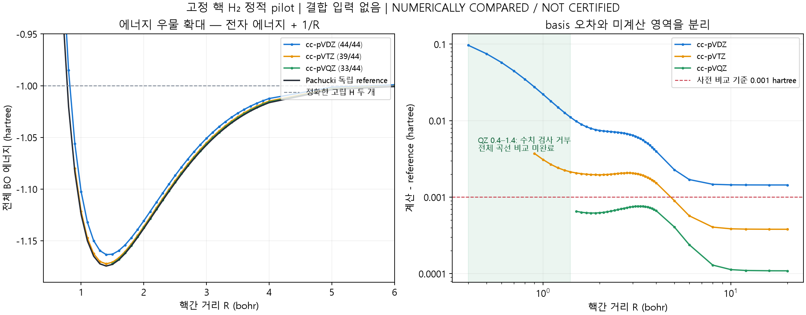

# 고정 핵 H₂ 정적 전자구조 reference pilot V1

2026-10-02. **IMPLEMENTED / TESTED / NUMERICALLY COMPARED / NOT CERTIFIED.**
**부분 결과: DZ/TZ 안정 에너지 우물과 세 basis의 해리 방향은 관측됐다.
QZ 최소점과 전체 곡선 일치는 미해결이다.** 최종 foundation 승인·A-world 실행·
실제 H+H→H₂ dynamics·모든 화학·생명 증거가 아니다.

## 1. 먼저 공개하는 한계

132개 거리/basis 입력 중 **116 numerical result / 13 intentional numerical refusal /
3 refusal-message implementation errors**. 오류 포함 16점은 energy를 인정하지 않았다.
cc-pVTZ R=0.4–0.8의 5점, cc-pVQZ R=0.4–1.4의 11점이 빠졌다.
QZ는 최소점 근처가 전부 빠져 **P1 minimum UNRESOLVED**다. 남은 QZ 33점의
최대 외부 차이가 사전 0.001 hartree 안이라는 이유로 전체 곡선을 PASS시키지 않는다.

physical/model 조건은 비상대론·고정 핵·isolated Coulomb·전자 2개·singlet이다.
finite basis와 binary64 적분/행렬 계산을 사용한다. certified interval,
CPU/GPU 또는 플랫폼 간 비트 동일성, 실제 전자 time evolution은 제공하지 않는다.
핵 운동/zero point·전자 여기/ionization continuum·radiation·relativity/QED·
nuclear spin/ortho-para·forces/Pulay는 지원하지 않는다. 제외 물리의 일반 chemistry
누적 영향 상한도 미확보이며 foundation로 확대하지 않는다.

## 2. Git state / 읽기 범위 / 구현 자산

시작 master, HEAD와 local remote-tracking origin/master 모두
`f7c2c8dc2f46bc510b8399aadb3b690ef8fef313`, ahead/behind 0/0, dirty 0.
이번 요청은 commit 허용 / push 금지다. network fetch는 하지 않았으므로
origin/master는 로컬 tracking 상태다. 최근 관련 `f7c2c8d` Drude 비교 후보 보존,
`71ab2b3` 이전 material 추천, foundation 문서는 `f7c2c8d`에 있다.

첨부 요청 전체, AGENTS/RULES, CURRENT_STATE/REPO_MAP 및 foundation V0를
읽고 작업 대상과 관련 기준을 확인했다. CURRENT_STATE의 긴 역사 기록은
범위를 나누어 확인했다. 저장소 전체 코드·기존 runs 전체 감사는 하지 않았다.
문서 안내/분류표와 기존 atomic/electronic 후보 비교의 §5 Hamiltonian,
§6 수치 witness 한계, §7 비용, §8 pilot 경계를 이번 구현과 대조했다.

새 연구 자산: [executor](../../electronic_pilot/solver.py),
[campaign](../../electronic_pilot/campaign.py),
[독립 reference checker](../../electronic_pilot/check_reference.py),
[구조/결함 주입 시험](../../tests/test_h2_static_pilot.py),
[WSL integration 시험](../../electronic_pilot/test_integration.py).
engine/a_reference/a_numeric/audit/research_store에 통합하지 않는다.
기존 executable/common/frozen fixture/contract를 수정하지 않았다.
documentation에 이 연구의 위치만 연결했다. C1-B1 Gate·기존 O-1 STOP·A-EV·
④-Liveness NotCertified·production verifier·D_valid를 승격하지 않는다.

## 3. 선택한 Hamiltonian / representation / solver

정본: [실행 전 사양](H2_STATIC_REFERENCE_PILOT_PROTOCOL_V1.md),
[V1 입력](../../electronic_pilot/protocol_v1.json),
[실패 수집 정책만 개정한 V2](../../electronic_pilot/protocol_v2.json),
[실제 실행 전 seal](h2_static_pilot_v2/seal.json).

`He = -1/2 Σi ∇i² - ΣiA 1/riA + 1/r12`,
`ENN = 1/R`, **`EBO = Ee + ENN`** (bohr/hartree).
두 proton `(0,0,±R/2)`, 전자 2개. spatial-symmetric singlet 전체의 낮은
numerical eigenpair를 구한다. 별도 gerade/orbital occupation 조건을 주지 않는다.
antisymmetric spin singlet과 결합해 전체 전자 교환 antisymmetry를 만족한다.

standard contracted real spherical cc-pVDZ/VTZ/VQZ Gaussian basis, PySCF 2.12.1
/libcint integrals, canonical S^-1/2 정규직교화, 직접 singlet matrix + SciPy LAPACK
evr lowest two eigenpairs. nuclear repulsion은 electron matrix에서 제외하고 한 번 더한다.
SCF·geometry optimization·warm start·bond ID·reaction table·known equilibrium input·
H₂ fitted PES가 없다. 표준 basis 계수를 이번 곡선에 fit/조정하지 않았다.
원자 중심 basis는 함수의 표현 위치이며 bond graph가 아니다.

선택 이유: 두 전자 full CI는 finite basis 안의 correlation를 빠짐없이 포함한다.
HF의 stretched static-correlation 오류나 DFT의 XC 선택을 이 첫 질문에 추가하지
않으며, M(M+1)/2의 작은 singlet space를 직접 다룰 수 있다.
수소 Gaussian 적분을 새로 구현하는 대신 공개 backend를 쓴다. 그 backend 자체를
독립 적분 코드로 검증한 것은 아니다. exponential explicitly-correlated solver는
더 강한 reference를 제공하지만 새 integral recursion/고정밀 구현 부담이 크다.
이 선택은 연구 evaluator 선택이며 production foundation 결정이 아니다.

## 4. 실제 E(R) / P1 / P2 / P3

V1 sanity는 R=0.4,2,20에서 시작해 TZ 첫 짧은 거리에서 중단됐다.
V2는 원래 grid·law·basis·tolerance를 유지하고 실패한 점에서 끝낸 뒤 **다른 독립
거리만** 한 번씩 실행했다. grid는 0.4–4 bohr 0.1 간격과 5,6,8,10,12,16,20.
44 points × 3 bases, atomic H 3 + ghost H 12 = 147 jobs.

| basis | 계산된 곡선 점 | P1 | 내부 표본 최소 EBO (hartree) | 표본 bracket |
|---|---:|---|---:|---|
| cc-pVDZ | 44/44 | SAMPLED MINIMUM FOUND | −1.163398731997143 at R=1.4 | [1.3,1.5] bohr |
| cc-pVTZ | 39/44 | SAMPLED MINIMUM FOUND | −1.172334593544404 at R=1.4 | [1.3,1.5] bohr |
| cc-pVQZ | 33/44 | UNRESOLVED | 최소값/위치 미판정 | 짧은 쪽 support 경계가 R=1.5 |

QZ의 가장 낮은 **계산된 값**은 R=1.5에서 −1.172201779370602다.
계산된 support의 끝점이므로 equilibrium/minimum 값으로 부르지 않는다.
DZ/TZ에서도 0.1 grid의 내부 표본 최소이며 연속 minimum의 precise 위치·엄밀 존재
증명 또는 실제 핵의 안정 동역학을 제공하지 않는다.

R=1.4에서 total energy owner를 직접 확인하면:

| basis | electronic Ee | ENN=1/1.4 | EBO |
|---|---:|---:|---:|
| DZ | −1.877684446282857 | 0.714285714285714 | −1.163398731997143 |
| TZ | −1.886620307830119 | 0.714285714285714 | −1.172334593544404 |

**P2: 세 basis 모두 선언한 해리 방향 진단 만족.** R=10/12/16/20에서
`|EBO−2EH_same_basis|`가 감소하고 R=20 차이는 각각
6.52e−9 / 3.34e−8 / 5.63e−8 hartree로 사전 1e−6 안이다.
그러나 `2EH_same_basis` 자체의 정확한 −1 hartree 대비 오차는
0.001443193 / 0.000380377 / 0.000108863 hartree다.
같은 basis로의 해리가 맞아도 continuum asymptote의 정확성이 해결되지 않는다.
finite R=20도 infinity가 아니며 dispersion tail이 남는다.

**P3: 전체 곡선 비교 미완료, quantitative 전체 PASS 아님.**
[Pachucki의 고정밀 BO 원고 v2](https://arxiv.org/pdf/1007.0322v2) Eq.2/Table IV는
동일한 고정 핵 비상대론 singlet 조건의 다른 exponential/explicitly-correlated 방법이다.
Gaussian executor와 공개 reference 계산의 evaluator를 공유하지 않는다.
[reference CSV](../../electronic_pilot/reference_pachucki_v2.csv)의 44개 값 및
인쇄된 uncertainty를 archived PDF에서 재추출해 44/44 대조했다.
[출처 해시·전사 검증](h2_static_pilot_v2/reference_transcription.json).
R=16,20에는 괄호 uncertainty가 인쇄되지 않았으며 0으로 처리하지 않았다.
Table III/IV R=12의 마지막 자리 차이도 있기에 정본 Table IV를 고정했다.

| basis | 비교 가능한 점의 max abs difference | 위치 | 전체 44점 기준 |
|---|---:|---:|---|
| DZ | 0.0968337119 hartree | R=0.4 | 작은 basis의 큰 discrepancy; 0.001을 초과 |
| TZ | 0.00372763323 hartree | R=0.9 | 일부 거부 + 관측 차이도 0.001 초과 |
| QZ | 0.000762524510 hartree | R=3.3 | 33점만 기준 이내; 11점 누락으로 전체 불인정 |

원고 abstract/Table I의 reference 근방은 R=1.4011, E=−1.1744759314002167
hartree이다. DZ/TZ의 R=1.4 energy와 **같은 거리**의 reference 차이는
0.0110769822 / 0.00214112068 hartree다. 정확한 고립 H 기준 표본 깊이는
0.163398732 / 0.172334594 hartree. finite grid·basis error가 섞인 표본 깊이를
true dissociation energy로 보고하지 않는다. QZ minimum 위치·깊이 비교는 미판정이다.

## 5. 별도 오차 장부 / 실패 원인

| 항목 | 실제 evidence / 정직한 경계 |
|---|---|
| physical/model approximation | 고정 핵·비상대론·singlet·isolated static target. reference와 target이 맞지만 실제 모든 physics가 맞는 것은 아님. 제외 physics의 범용 영향 상한 없음 |
| basis/representation error | 표준 DZ/TZ/QZ sequence와 atomic basis discrepancy. DZ/TZ minimum 오차 및 공통 점에서 refinement 차이 관측. 순서/차이를 continuum rigorous bound로 세지 않음. grid resolution 0.1 bohr |
| solver convergence | accepted rows의 정규직교 finite matrix residual 최대 DZ 6.07e−13, TZ 2.17e−11, QZ 8.11e−12 hartree. direct eigensolve라 iteration_count=null. residual은 어느 numerical eigenvalue에 가까움의 진단이지 ground root/continuum 인증 아님 |
| arithmetic / numerical / backend | S^-1/2 및 ERI transformation에서 amplification, 아래 13 numerical refusals. binary64이고 interval bound 없음. 다른 LAPACK driver·기하 불변성·same-integral FCI 비교는 표본 검사 |
| reference uncertainty | 공개 논문 값과 uncertainty를 사용, 계산을 독립 재현하지 않음. 전사 확인과 reference의 수학적 신뢰는 다름. 16/20 uncertainty 미기재 |

**13 intentional refusal:** TZ 0.4–0.8, QZ 0.7–1.4. transformed singlet matrix
asymmetry가 실행 전 고정 1e−10을 초과했다. 예: TZ 0.4에서 2.12e−9,
QZ 0.7에서 1.98e−7. 최소점에 가까운 QZ 1.4에서도 1.83e−10으로 거부됐다.
행렬을 평균으로 대칭화하거나 threshold를 늘려 통과시키지 않았다.

**3 implementation errors:** QZ 0.4/0.5/0.6에서 orthonormalization guard의
진단 f-string에 `orth`를 써 NameError가 났다. `orth_error`로 **메시지만** 고쳤다.
accepted energy 계산 경로에는 변화가 없다. 그 후 별도 integral-stage 진단에서
orthogonality error는 1.69e−9 / 4.95e−10 / 3.89e−10, condition은
9.84e6 / 1.09e7 / 2.86e6으로 같은 1e−10 guard를 넘었다.
이 진단은 새 electronic energy가 아니며 132-point curve를 다시 돌리지 않았다.
[원래 실행 solver](h2_static_pilot_v2/solver_executed.py.txt),
[원래 rows](h2_static_pilot_v2/results.json),
[후속 진단](h2_static_pilot_v2/orthogonality_message_diagnostic.json),
[소스 변경 의미](h2_static_pilot_v2/postrun_source_note.json)를 따로 보존한다.

현재 evidence는 arithmetic/conditioning/representation implementation의 제한을
지지한다. H₂ minimum이 없는 물리 반례, continuum Coulomb law 실패, PySCF 전체의
결함이라고 판정하지 않는다. binary64 AO integral error amplification의 rigorous
분해와 더 안정적인 evaluator의 교차 계산은 미실행이다.

추가 BSSE 진단: ghost basis를 더한 isolated H의 energy 변화는 R=6에서
DZ −7.15e−6 / TZ −1.92e−6 / QZ −5.81e−7 hartree. R=20에서는
binary64 noise 규모(약 1e−16)다. 보정을 world potential로 주입하지 않았다.
큰 R reference tail 차이에는 atomic basis error와 부족한 finite-basis dispersion가
함께 있고, 같은 atom asymptote 검사만으로 tail 정확성을 인증하지 않는다.

## 6. 계산 비용과 확장 병목

로컬 Ryzen 5 5600 / Windows 호스트 / Ubuntu-24.04 WSL / Python 3.12.3,
NumPy 2.5.3, SciPy 1.18.1, PySCF 2.12.1, native numerical threads 1.
각 job은 fresh spawned process, 순차 실행했다. Vast/원격/GPU 사용 0, 원격 비용 $0.
전체 147 jobs **218.303초 wall**. accepted curve CPU 합 138.437초이며 실패/원자/
startup을 포함한 campaign 전체 CPU라고 보고하지 않는다.

| basis | M | singlet dimension | accepted solve wall 합 | point wall 중앙값 | process peak RSS 최대 |
|---|---:|---:|---:|---:|---:|
| DZ | 10 | 55 | 9.231초 | 0.202초 | 96.13 MiB |
| TZ | 28 | 406 | 17.029초 | 0.376초 | 127.23 MiB |
| QZ | 60 | 1830 | 129.472초 | 3.863초 | 442.27 MiB |

wall은 integral·assembly·diagonalization·NPZ artifact 기록과 selected secondary
FCI checks를 포함한다. 별도 startup 포함 worker wall도 저장했다.
RSS는 fresh Linux process high-water로 imports/전체 solve/artifact 작업을 포함하며
matrix만의 크기가 아니다. 다른 로컬 부하를 완전히 통제하지 않았고 반복 median
성능 실험이 아니라 서로 다른 R점의 중앙값이다. 실패 점의 비용을 성공 시간에 섞지 않는다.

두 전자 singlet dimension D=M(M+1)/2. ERI storage O(M⁴), explicit product/singlet
matrix O(M⁴), dense eigensolve의 일반 구조 O(D³)≈O(M⁶)가 병목이다.
QZ ERI array 103,680,000 bytes, singlet matrix 26,791,200 bytes 외에 transient
product matrix/copies/LAPACK/정규직교화가 더해진다.
전자 수까지 늘면 full CI determinant space `binom(M,Nalpha)*binom(M,Nbeta)`가
조합적으로 증가한다. matrix-free라도 vector 차원이 사라지지 않으며 ground-state
문제를 큰 물질·매 시간 step·독립 검증에 그대로 적용하는 비용은 더 크다.
큰 원자/전자계를 실제로 실행하지 않았고 production 규모를 자동 선택하지 않는다.

## 7. TESTED / 개념 대조 / 증거 보존

Windows 최종: **25 passed, skip/failure/error 0, 0.78초**
(신규 structural/fault tests 22 + 기존 body freeze 3).
WSL 최종: **27 passed, skip/failure/error 0, 2.38초**
(동일 structural 22 + PySCF integration 5). 같은 시험을 두 번 실행한 값을
합쳐 unique 시험 수로 보고하지 않는다. WSL integration은 production FULL 밖의
명시적 연구 dependency 경로이며 Windows에서 skip으로 몰래 대체하지 않았다.

검사: independent fermionic creation/annihilation spectrum과 singlet assembly 대조,
noninteracting limit, unsupported input, missing/double nuclear repulsion, wrong
electron/spin, NaN, residual failure, missing/duplicate point, incomplete subset
false promotion 방지, high reference difference, checker의 금지 import,
V1/V2 physics/tolerance 동일성. integration은 rotation/translation/proton exchange,
다른 LAPACK driver, atomic H/해리, non-Hermitian 및 orthogonality fault injection이다.
secondary PySCF FCI 11 computed points는 모두 converged, 최대 차이 4.49e−11
hartree. Gaussian integrals를 공유하므로 독립 physical checker라고 하지 않는다.

개념 2차 대조(작성자 소스/입력 경계 검토, 별도 agent 승인 아님): 입력에서 bond,
molecule=true, known equilibrium, bond-order를 참조하지 않는다. 각 R는 독립 static
Hamiltonian 문제이고 전자 에너지를 minimum 판단에 단독 사용하지 않는다.
reference는 사후 비교에만 쓰며 계산값을 force/PES lookup으로 대체하지 않는다.
결과가 부족하다고 기준/basis를 바꾸지 않았다. singlet 선택·고정 핵·finite basis·
whole-system ground-state solve 자체의 제한은 공개되어 있다.
AUTOMATIC TEST PASS ≠ PHYSICAL ACCURACY ≠ CERTIFICATE를 유지한다.

**LOCAL FULL 생략 / 관련 시험으로 대체 / 이유:** 새 독립 pilot·시험 및 문서만,
기존 executable/common/frozen contract/fixture 불변. 공식 기준선 갱신 없음.
raw NPZ 행렬/coefficients와 개별 point logs는 `runs/h2_static_pilot_v2/full/`에 보존,
Git에는 compact results/seal/refusal/test evidence를 저장한다.
[raw SHA-256 manifest](h2_static_pilot_v2/raw_manifest.json)의 주소가 원본을 가리킨다.
Git JSON 요약은 wavefunction 원본과 같지 않으며 그 자체로 재검증 인증서가 아니다.
새 pilot/evidence 폴더의 `.gitattributes`는 Windows 줄바꿈 자동 변환을 막아
seal·소스 snapshot·복사된 원본 자료의 바이트를 보존한다.

실패 기록: 처음 지정한 WSL home 경로 권한 실패, /tmp venv가 후속 호출에서
없어 새 home venv를 사용한 환경 준비 문제, diagnostic 스크립트 괄호 SyntaxError,
PDF 전사의 decimal-point whitespace 파서 최초 0-row 오류, Windows cp949 print
오류, plot minus-glyph 경고와 집계 임시 코드 IndexError를 발견했다.
전사 파서는 수정 후 44/44, plot은 숫자 tick label 수정 후 실제 PNG를 확인했다.
이 도구 실패를 physical-model 불일치나 해결된 production 인코딩 경고로 세지 않는다.
원래 sanity 실패와 V2 refusal/NameError는 source/seal/rows 그대로 보존했다.

## 8. 확인한 것 / 미확인 / 다음 설계자 결정

확인: DZ/TZ finite-basis singlet full CI에서 사전 bond 규칙 없이 낮은 total BO
에너지 우물이 관측됨; 세 basis의 같은-basis fragment 방향; QZ supported 33점의
독립 고정밀 curve와 차이; 실제 비용 및 작은 basis/수치 guard의 실패.
미확인: QZ minimum·44-point agreement·continuum exactness·formal proof·전자/핵
dynamics·실제 formation capture·forces·새 원소/charge/spin chemistry·A 전체 물질.

**DESIGNER DECISION REQUIRED:**

1. 추천 우선순위는 **동일 Hamiltonian/basis의 더 안정적인 정규직교화·integral
   transformation/고정밀 evaluator를 검토해 short-R/QZ refusal 원인을 독립 분리**하는 것이다.
   tolerance 확대나 basis 삭제를 해결로 삼지 않는다. 현재 곡선·실패 원본을 비교군으로 유지한다.
2. QZ 최소점 및 전체 curve가 확보된 뒤 더 높은 basis/explicitly-correlated method와
   target accuracy를 결정한다. HF/DFT/ML로 계산법을 몰래 교체하지 않는다.
3. atomic H/H₂⁺·triplet/charge/field의 별도 반증 panel을 이후 승인할 수 있다.
   이번 singlet reference를 그 sector의 oracle로 사용하지 않는다.
4. production authoritative electronic state, quantum/BO 과정 보존, measurement/history,
   dynamics 및 규모는 별도 foundation 결정이다. 이번 결과로 승인하지 않는다.

이번 pilot은 **실행·부분 수치 비교 완료 / 완전한 성공 기준 미충족 / NOT CERTIFIED**로 남긴다.
