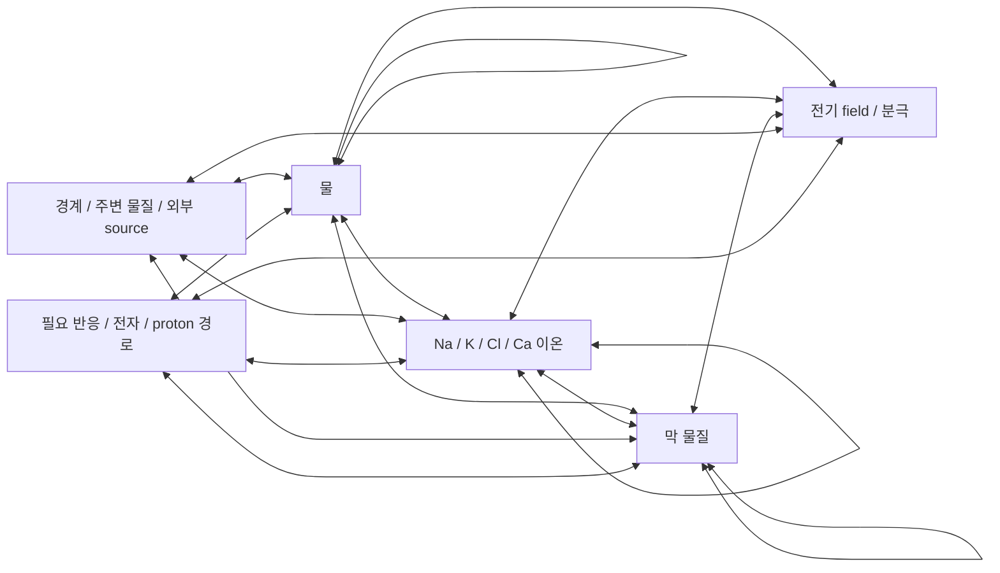
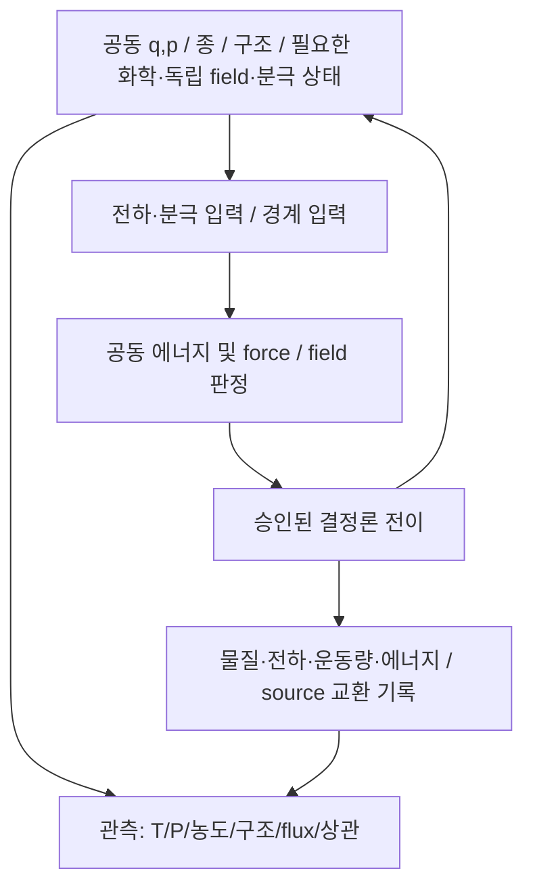
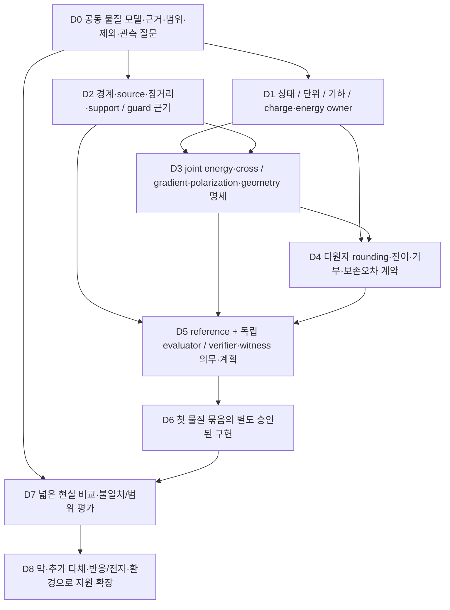

# Stage 1 Physics Support Map V0

2026-10-02 · **DESIGN ONLY / PRE-IMPLEMENTATION / READY FOR DESIGNER REVIEW**
기준 HEAD `994c6a019a42dd78bc13c0fa470ab564c4fa4d70`.

**먼저 공개할 한계:** 현재 real-material A는 이 문서의 물·이온·막 세계를 지원하지 않는다. 문헌의 일부 물성 검증도 Stage 1 전체의 검증이 아니다. 이번 지도는 필요한 물리와 의존성을 펼친 설계 산출물이며, 모든 모델의 적용 범위·오차·guard를 이미 닫았다는 뜻이 아니다. 확인하지 못한 범위는 `UNRESOLVED`로 남겼다. 물/ion model·경계·dt·rounding·production 규모를 선택하지 않는다.

요청한 네 산출물은 **§2–3 전체 Physics Support Map, §4 Interaction/Coupling Graph 및 ledger, §5 Unsupported/Unresolved List, §9 구현 의존 순서**다. 첫 구현 추천은 §10에 있다. 단계의 전체 목표를 먼저 지도화했으며 첫 구현 묶음이 그 전체를 대신하지 않는다.

## 1. 이 지도에서 “지원”의 의미

Small은 **공간·물질량·계산 영역**이 작다는 뜻이다. 물리 기능 축소나 관심 밖 상호작용의 삭제가 아니다. [Neuron Stress-Test Roadmap](SMALL_A_NEURON_STRESS_TEST_ROADMAP_V0.md)의 Stage 1에서 요구한 물·주요 이온·전하·전기적 상호작용·field·분극·열·확산·막 물질·장거리·다체 효과를 모두 지도에 둔다. 반응/pH/proton·전자 관련 경로도 지원 여부와 제외 의무를 명시하며 Stage 2라는 이유만으로 0 처리하지 않는다.

서로 다른 다섯 범위를 분리한다.

| 범위 | 무엇을 말하는가 | 이것만으로 주장할 수 없는 것 |
|---|---|---|
| 표현 가능 | 후보 법칙/상태 schema에 그 자유도·사건이 존재 | 실제 A 구현, 현실 타당성 |
| fitting/calibration | 매개변수 결정에 사용한 자료·조건 | 같은 조건에서의 독립 예측 성공 |
| 실제 평가 | 논문/시험에서 평가한 조건·크기·기간·관측량 | 사이 조건 전체·장기·다른 혼합물의 안전 범위 |
| 근거 있는 적용 범위 | 물질·상태·조건·공간/시간·제외 경로와 오차를 정당화한 범위 | 범위 밖 외삽, 다른 법칙과의 조합 자동 승인 |
| 엄밀한 보장 | 명시된 전제 아래 enclosure·guard·반올림·전이 등에 대한 보장 | 사용한 현실 모델 자체의 완전성 |

논문의 test points를 연속 직사각형의 support proof로 만들지 않는다. 실행 기간은 현실 타당성의 보증 기간이 아니다. 관측량별 오차와 모델·수치·표본·계측 오차를 분리한다. 정확한 결정론 계산도 부정확한 물리 모델을 계산할 수 있다.

현재 판정은 유지한다.

- [Deterministic Initial State Pilot](REALITY_CONSTRAINED_DETERMINISTIC_INITIAL_STATE_V0.md): **E — REALITY_DATA_INSUFFICIENT**, 승격 없음.
- [Microstate Preparation Contract](REALITY_CONSTRAINED_MICROSTATE_PREPARATION_CONTRACT_V0.md): **proposal / designer decision pending**, M1/M2/M3/M4 미선택.
- [C1-C Foundation](C1C_MULTIPARTICLE_GAS_FOUNDATION_V0.md): 미구현·미승인 제안. 기존 Ar 계약과 D_valid는 새 물질의 계약이 아니다.
- 현재 Gate·A-EV·O-1 STOP·NotCertified·Yoshida 후보 상태는 [CURRENT_STATE.md](../../CURRENT_STATE.md)를 따른다. 이 지도는 Gate 종료나 실행 우선순위 변경이 아니다.

## 2. Stage 1 전체 Physics Support Map — 상태와 상호작용

아래 P-ID는 **요구 물리**, C-ID(§3)는 **조사한 후보 모델/계산 계층**, O-ID(§6)는 **현실 비교 관측량**, D-ID(§9)는 **구현 의존성**이다. 물리적 계층과 코드 모듈을 동일시하지 않는다. 열·확산·field는 선택한 법칙에 따라 별도 상태 또는 입자 상태의 관측/파생값일 수 있다.

| P-ID / 대상 | 필요한 상태의 이유와 조건부 표현 | 영향을 주고받는 항 / 후보 | 현재 A의 지원 및 새 검증 의무 |
|---|---|---|---|
| P01 물 | 원자 q,p·원소/동위원소·질량, 분자 내 결합/구조. rigid 표현이면 위치/회전·운동량 또는 atomic constraints 중 authoritative 표현을 정함. virtual site는 기하에서 유도 가능 | water↔water, water↔ion/막/field; C01/C02/C03 | **NOT YET IMPLEMENTED**. intramolecular·반발/분산·영구 전기·분극 등 공동 에너지, 기하/구속/가상 site 힘 전달·torque 검증 |
| P02 Na⁺/K⁺/Cl⁻ | 이온 q,p·species·질량·산화/화학 상태의 선언. formal net charge와 potential의 effective charge는 구분 | 이온↔물/이온/막/field; C04 | **NOT YET IMPLEMENTED**. water별 매개변수·cross term·혼합 조성·농도/표면 검증. species 이름이나 ID가 힘을 임의 선택하지 않음 |
| P03 Ca²⁺ | P02 및 수화/배위·필요한 분극/전자 관련 표현. 단가 이온의 charge를 +2로 바꿔 대체하지 않음 | Ca↔물/Cl/다른 이온/막·field; C05 및 분극 후보 | **NOT YET IMPLEMENTED**. 배위/수화/이온 pair/막 결합의 별도 근거. ligand 교환과 공유결합 반응은 구분 |
| P04 전하 | formal charge·partial/effective charge·필요하면 전자/화학 상태에서 유도된 charge. charge 값이 상태인지 고정 매개변수인지 구분 | 모든 charged/polar 물질과 경계/source | **NOT YET IMPLEMENTED**. 전하/원소/경계 장부, 전하 배분 규칙·변화의 에너지 의미. scaled charge를 별도 물리 전하와 혼동 금지 |
| P05 전기적 상호작용 | charge/dipole/multipole 등 모델 입력과 공동 에너지 명세. electrostatic 힘은 승인된 에너지와 일관되게 계산 | Coulomb·multipole·분극·short-range damping, 물질↔source | **NOT YET IMPLEMENTED**. self term·excluded pair·구속/결합 항·cross term·boundary term과의 중복/누락, 힘/에너지/전이 검증 |
| P06 전기장/전위 | electrostatic φ,E는 전하·분극·경계의 파생값일 수 있음. 동적 electromagnetic 계층이면 독립 E/B 또는 동등한 field 상태·제약·에너지가 필요 | field↔ion/water/막/분극/source; C08/C09 | **NOT YET IMPLEMENTED / 계층 선택 UNRESOLVED**. gauge·boundary·전하 분리·외부 일. 정전기/준정적 모델의 시간·공간 범위 및 인과 의미를 심사 |
| P07 분극 | induced dipole를 매 상태에서 풀면 파생 변수/solve witness 후보. 동적 auxiliary 모델이면 위치·운동량·질량 등의 실제 자유도 필요. 두 표현을 섞지 않음 | local field↔분극↔다른 물질의 field/force; C02/C03/C05/C08 | **NOT YET IMPLEMENTED**. stability/해 존재·선택/유일성·잔차→힘/에너지 오차·rounding 결정. 단순 수렴 flag는 건전성 증거 아님 |
| P08 열/에너지 수송 | 입자 운동·구조·field/분극·화학 에너지와 외부 교환. 선택 모델에 없는 열 자유도를 임의 추가하지 않음 | 모든 물질의 운동·충돌·구조·경계↔열/일 교환 | **NOT YET IMPLEMENTED**(물 계통). T는 정의된 DOF/window의 측정 후보. 보존, 에너지 분해, 누락 진동/전자/auxiliary DOF·계면 열수송 검증 |
| P09 확산/이동 | 입자 q,p 및 추적/경계 이력으로 이동을 계산. D나 flux는 보통 파생 관측량 | 상호작용→이동→농도/전하→field→힘 | **NOT YET IMPLEMENTED**. 확산 계수를 맞추는 random kick/임의 friction 금지. long-time 수송·전류 상관·경계/finite-size 검증 |
| P10 단순 막 물질 | 지질/막 분자의 q,p·구성·결합·화학/전하 상태, 필요한 분극. “막”·“불투과” flag를 물리 원인으로 사용하지 않음 | membrane↔water/ion/membrane/field; C06 | **NOT YET IMPLEMENTED**. 구조/기계/전하·수화·투과·환경 결합. pore/재배열과 화학 결합 파괴를 분리; 완성 뉴런/채널 삽입 아님 |
| P11 장거리 상호작용 | 전하/분극/source·경계·필요한 image/field representation. grid/tree는 계산 표현 | 전기·분산 등의 장거리 항, boundary↔전체 상태 | **NOT YET IMPLEMENTED**(새 계통). Coulomb와 분산을 같은 cutoff 법칙으로 처리하지 않음. 경계·tail·가속 enclosure·전체 영향 cache 검증 |
| P12 필요한 다체 효과 | 공동 q/구조에서 유도된 에너지 또는 분극/전자 자유도. pair 합에 포함된 효과와 별도 many-body term 구분 | water clusters·이온 수화·분극/배위·막 계면 | **NOT YET IMPLEMENTED / 필요한 항 목록 UNRESOLVED**. pair/dimer 성공만으로 삭제하지 않음. 집단/혼합 상태와 에너지/force 일관성 검증 |
| P13 밀도/압력·기계 응답 | 부피/기하·q,p·결합/힘·경계. density/P는 측정 후보이며 필요하면 물리 경계 자유도 선언 | 입자/막/환경의 응력·충돌·일 | **NOT YET IMPLEMENTED**(Stage 1). EOS·constraint virial·anisotropic 막 응력·finite-size. 압력을 목표값으로 snap하지 않음 |

필요 없는 상태를 모두 강제로 넣지 않는다. atomic q,p와 rigid-body q/회전 상태를 독립적으로 중복 소유하지 않는다. species/mass는 versioned 물질 계약에서 가져올 수 있으며 별도 자유도일 필요는 없다. 고정 모델의 bond/charge 매개변수와 실제 반응에서 변화하는 상태도 구분한다. 일반 electronic state는 모델이 요구할 때 추가한다. Ar potential 안의 BO/상대론/QED 보정은 일반 전자 계산기의 구현이 아니다.

## 3. 후보별 Support Map — 조건·공간·시간·오차·guard

**아래 모든 C-ID는 조사/설계 후보이며 A에 채택되지 않았다.** 보고된 조건·오차는 문헌의 해당 물성과 준비에서의 기록이다. 후보의 장점, 제외 경로, Stage 1 조합의 적용 근거를 구분한다. 공간·시간 범위를 확인하지 못했다고 임의 숫자로 채우지 않는다.

| C-ID / 모델 계층 / 지원 물질·표현 | 문헌에서 확인한 조건/평가 또는 역할 | 공간·시간·알려진 오차의 범위 | 제외/부족 경로·A 적용 판단 및 guard 가능성 |
|---|---|---|---|
| C01 고정 topology·고정 charge의 rigid/flexible 물: TIP4P/2005 등의 사례 | NIST의 TIP4P/2005 benchmark는 rigid 물의 coexistence/EOS 등 **지정 수치 모델 결과**를 제공. 실험 현실 전체의 인증이 아님 [R1](https://www.nist.gov/mml/csd/chemical-informatics-group/benchmark-results-tip4p2005-water) | 정확 비교에는 NIST의 개별 조건/long-range 처리 등 동일 명세가 필요. 이번에 모든 benchmark point·T/n 범위·동역학 시간/공간·현실 오차는 추출하지 않음: **UNRESOLVED** | rigid에서는 내부 진동, fixed topology에서는 일반 결합 교환/해리·protonation이 표현되지 않음. 기하/숫자/선언 조건 guard는 후보이나 제외 반응의 안전 영향 판정은 **UNRESOLVED** |
| C02 분극 물 HIPPO 사례: water charge penetration·분극·charge-transfer 에너지항·반발/분산 | fitting: density/증발 enthalpy/dielectric, 261–373 K. 평가: 순수 물 1 atm, 248–373 K의 온도 의존 물성 [R2](https://arxiv.org/pdf/2106.13116) | 논문 기본 물성 계산 약50 Å/4,200 water, 적어도20 ns 조건; 확산은 다른 큰 box/protocol. 298 K 확산이 실험보다 약11% 높다고 보고. 이는 관측 편차이며 전체 범위 오차 상한 아님 | 이온/막/반응·일반 전자이동 검증이 아님. charge-transfer **에너지항**은 redox/ionization/proton 반응 지원 증거 아님. solver와 물질/조건 guard는 새 설계 필요; joint Stage 1 범위 **UNRESOLVED** |
| C03 many-body 물 MB-pol 사례: water clusters/liquid/ice | 논문 abstract의 liquid structure X-ray 비교 268–368 K, atmospheric pressure; 다체 cluster 에너지와 다른 물성 비교 [R3](https://arxiv.org/abs/1609.02884) | 조건별 크기·기간·각 물성 수치 오차/범위는 이번 abstract 확인에서 미확정. nuclear quantum effects의 중요성도 보고. 구조 일치를 dynamics/열 전체로 승격하지 않음 | Na/K/Cl/Ca·막/반응 조합은 해당 근거로 지원되지 않음. “many-body”라는 이름만으로 제외 경로가 사라지지 않음. 범위 판정과 런타임 guard **UNRESOLVED** |
| C04 Joung–Cheatham 단가 이온 사례: Na/K/Cl 등을 포함한 alkali/halide, additive nonpolarizable model | TIP3P/SPC/E/TIP4P-Ew 각각에 대응하는 매개변수와 Ewald 처리 조건; 수화 자유에너지·구조·결정/solution 관련 평가 [R4](https://pmc.ncbi.nlm.nih.gov/articles/PMC2652252/) | 서로 다른 단일이온 자유에너지 추정의 convention 주의. 이번에 전체 T/n/농도·크기·기간 및 error table 미확인: **UNRESOLVED** | Ca²⁺와 다른 물 모델/막/전체 mixed salt에 자동 확장 금지. cross term/혼합 규칙·effective charge 재심사. 종/선언 상태 판정 가능 후보와 물리 적용 guard의 건전성 미확정 구분 |
| C05 divalent ion-induced dipole를 유효항으로 다루는 12–6–4 사례 | Li–Merz는 TIP3P/SPC/E/TIP4P-Ew용 16개 +2 금속 ion을 대상으로 HFE/IOD/CN 비교. 기존 12–6의 동시 물성 재현 문제와 charge-induced dipole 항을 논의 [R5](https://pmc.ncbi.nlm.nih.gov/articles/PMC3960013/) | abstract/Methods 근거는 물 모델별 매개변수 필요성을 보임. Ca별 숫자·전체 mixed Ca/Na/K/Cl·농도/온도·막/기간/크기 안전 범위는 이번 조사에서 **UNRESOLVED** | explicit charge transfer 없음이라는 제한을 저자가 명시. explicit 분극을 그냥 더하면 중복 위험. Ca²⁺의 적용/guard는 독립 근거와 joint 검증 필요; 본 표는 Ca 모델 채택 아님 |
| C06 비반응 지질/막 force-field 사례: CHARMM36 6 lipid validation | 논문은 구조·area 등 비교를 보고하며 DPPC의 323.15 K area isotherm이 한 평가 사례 [R6](https://pmc.ncbi.nlm.nih.gov/articles/PMC2922408/) | 해당 lipid·준비·물/ion·장거리 구현 조합의 검증이어야 함. 이번에 모든 조성·공간·기간·투과/thermal/electrical 오차 범위를 검토하지 못함: **UNRESOLVED** | 구조 validation ≠ permeability/반응/다른 막 전체. 새 물·Ca 및 혼합물 결합은 새 검증. chemical rupture/해리·protonation은 단순 topology 모델의 지원이 아님 |
| C07 반응/전자/양성자 계층 후보 | water autoionization을 ab initio trajectory로 조사한 Geissler 등 사례 [R7](https://ucrisportal.univie.ac.at/en/publications/autoionization-in-liquid-water/). 특정 메커니즘 연구와 범용 reactive model의 안전 범위는 별개 | rate 상한·일반 물/ion/막 조건·T/n·기간·공간·전체 reaction set·오차는 **UNRESOLVED**. 미래 후보의 전자 근사/핵 quantum 효과 범위도 심사 | 지원 반응을 선언·검증한 새 모델/상태/energy ledger 필요. 미지원 반응을 런타임이 알아채는 일반 oracle은 없음. 현재 A **UNSUPPORTED** |
| C08 electrostatic/분극 solve 계층: Coulomb 직접 평가, Poisson/동등 경계값 solve, induced dipole 등 | 선택한 joint model의 전하·분극·경계에서 force/energy/field 계산. 물/ion의 현실 parameter validation을 대신하지 않음 | 해 존재/선택·conditioning·self/exclusion·경계·정밀도·잔차→오차/rounding. 아직 승인된 Stage 1 공간/시간/field 범위 없음: **UNRESOLVED** | direct Coulomb와 field는 같은 항의 서로 다른 계산일 수 있음. 정전기/준정적 적용 범위와 finite propagation 등은 별도 물리 판단. numerical guard 후보와 physical guard를 구분 |
| C09 동적 electromagnetic/더 상세한 전자 계층 후보 | 빠른 field 변화·전자 상태 변화 등 C08/C01–06의 적용 범위 밖 질문을 지도에 보존 | 어떤 조건에서 필요한지, 상태·공간/시간·오차·reference 비용/guard 모두 **UNRESOLVED**. 반드시 모든 경우 explicit 전자/Maxwell 상태를 요구한다고 확정하지 않음 | electrostatic 외삽으로 대체하지 않음. 상세 모델을 쓴다는 사실만으로 현실 타당성/결정론·검증 문제가 해결되지 않음 |

이 표에서 **NIST 모델 benchmark = 독립 현실 계측**으로 부르지 않는다. C02의 calibration 물성은 independent held-out 물성과 구분한다. 특정 논문의 thermostat/barostat/Monte Carlo/표본 준비/수치법은 문헌 방법이며 A의 법칙·준비·dt로 가져오지 않는다. 같은 조건을 요구하는 비교 기준도 A 실행 승인과 다르다.

### 3.1 P-ID 전체의 적용 범위 판정

| 요구 물리 | 조건·공간·시간 범위를 닫기 위해 필요한 근거 | 현재 알려진 오차/제외·guard 결론 |
|---|---|---|
| P01 | C01–03의 특정 물 모델/상·T/n/P·구조·운영 크기/기간 및 제외 반응 영향 | 물성별 사례만 확보. 전체 오차와 안전 지원 범위 **UNRESOLVED**, 실제 A는 미구현 |
| P02 | C04와 실제 water/막/혼합염·농도/ionic strength·field·기간/크기 | 개별 이온 calibration이 혼합계 보장 아님. cross model/error/physical guard **UNRESOLVED** |
| P03 | C05 또는 다른 상세 후보의 Ca 수화/배위·교차 항·농도·계면·시간 | +2 치환 불가. Ca mixed system/막 및 제외 전자 경로 영향 **UNRESOLVED** |
| P04 | charge 의미·speciation·source/boundary·총전하·화학 변화·범위 | 선언 charge 합 계산은 가능 후보, 실제 charge 변화/제외 경로 안전 판정은 **UNRESOLVED** |
| P05 | joint energy·cross/exclusion·거리/상태·field·경계·공간/시간 | 숫자 guard와 physical model range는 다름. 합성한 힘의 현실 오차/guard **UNRESOLVED** |
| P06 | 정전기/준정적/동적 선택의 근거, gauge·경계·전하/field·주파수/길이/기간 | field solve residual만으로 전체 물리 타당성 판정 불가. **UNRESOLVED** |
| P07 | 분극 선택·stability·국소 환경/장·conditioning·시간 모델·효과 포함 범위 | iteration residual로 제외 chemistry를 판정 못 함. force/energy enclosure 포함 **UNRESOLVED** |
| P08 | 물질/계면·열 DOF·평형/비평형 창·경계 교환·길이/시간·오차 | rigid/auxiliary/누락 DOF에 따른 열물성/수송 범위 **UNRESOLVED** |
| P09 | 장시간 transport와 크기/경계 의존성, 조성/field·환경·단일/집단 이동 | D 일치가 conductivity/rare crossing 지원을 뜻하지 않음. **UNRESOLVED** |
| P10 | 정확 조성·상·수화·표면 전하·기계/전기/투과·환경/길이/기간 | 구조 일부 근거 외 새 joint model 오차·제외 경로·guard **UNRESOLVED** |
| P11 | 실제 경계 조건·geometry·전체 source·장거리 법칙과 정확 가속 의무 | 원거리 항 삭제 금지. tail/field 오류·경계 영향·판정 근거 **UNRESOLVED** |
| P12 | 물/이온/막 다체 상태·상/농도/field 및 해당 기간/규모에서 pair 근사의 한계 | 다체 항의 필요한 목록·제외 누적 영향·safe guard **UNRESOLVED** |
| P13 | EOS/응력·구속 virial·열/일 교환·막 anisotropy·공간/시간 창 | T/P/n를 독립 snap할 수 없음. 실제 Stage 1 적용/error/guard **UNRESOLVED** |

**guard 조사 결론:** 형식·species inventory·정확 geometry·숫자 범위·선언된 경계·증명된 solver error의 검사는 설계 가능한 후보다. 반면 “미지원 반응이 없었음”, “온도 범위 안이므로 모든 local state 안전”, “논문에 없는 혼합물도 안전”을 판정하는 근거는 확보되지 않았다. 후자의 적용 근거가 없으면 `UNRESOLVED`이며 해당 현실 실행 영역을 지원한다고 승인할 수 없다.

## 4. Interaction / Coupling Graph와 소유·교환 장부

### 4.1 물질 상호작용 지도

다음은 **필요 영향 관계**이며 같은 항을 edge마다 중복 합산하라는 뜻이 아니다. field는 C08에서는 계산/파생 표현, C09에서는 독립 물리 상태일 수 있다.

현재 구현된 edge는 없다. 반응/전자 node의 일부도 미지원/미결이지만 지도에서 삭제하지 않는다. 모든 물질의 열·물질·에너지 교환은 이 관계를 따라 joint state에서 일어나며, 별도 목표 T나 막전위 node로 결과를 지시하지 않는다.

### 4.2 같은 상태를 통해 닫혀야 하는 coupling

O에서 세계로 돌아가는 화살표는 없다. 측정값을 읽어 목표값으로 보정하지 않는다. 분극 solve가 configuration마다 coupled equilibrium을 요구하면 결과와 force가 같은 energy model에 속해야 한다. solver 반복 중의 후보값을 독립적으로 확정 상태에 써서 계층별 목표값만 주고받는 구조는 금지한다. 위 그림은 실행 순서/동시 갱신/적분법의 최종 계약이 아니다.

### 4.3 Coupling ledger 후보

owner는 같은 world state의 authoritative 표현/계산 책임을 뜻한다. 별개 스크립트나 별개 세계가 각자 상태를 바꾸는 제안이 아니다.

| 조합 / L-ID | 상태 owner | 힘·에너지 owner / 교환 내용 | 이중 계산 위험과 필요한 계약 |
|---|---|---|---|
| L01 explicit water + implicit dielectric | 물 원자 상태와, 별도로 실제 뜻을 갖는 경계/전자 응답 변수 | joint electrostatic energy가 포함 효과를 한 번만 계산; charge·response·boundary energy/force | 같은 물의 orientational screening을 continuum ε로 다시 넣을 위험. 제외한 전자/외부 영역의 응답인지 근거·영역·interface가 필요 |
| L02 particle Coulomb + continuum/Poisson field | particles가 charge source 소유; electrostatic field는 파생 owner 또는 동적 field state | 한 electrostatic term을 direct 또는 field solve로 평가; charge density↔field/force, self/boundary/source work | direct 힘+같은 φ/E 힘을 더하면 중복. field energy와 particle potential energy도 같은 항을 두 번 합산하지 않음 |
| L03 explicit polarization + effective polarized potential | induced dipole solve witness 또는 auxiliary DOF; effective parameters는 versioned 공동 법칙 | polarization self/coupling energy와 response force를 joint model이 소유; field↔dipole·구조/에너지 | scaled charge·유효 12–6–4·고정-charge fitting에 포함된 효과를 다시 더할 위험. 원 parameter 유지+항 추가의 자동 허가 없음 |
| L04 explicit solvent + friction bath | explicit particles; 실제 bath 후보면 환경 DOF/경계 입력을 별도 소유 | 물/환경의 열·운동량 교환 한 번; reservoir 상태/교환 이력 | 물에 이미 있는 충돌·점성·열교환에 friction/난수 보상 추가 위험. 임의 damping/RNG 금지, M4 미승인. 유효 bath도 물리 범위/오차/장부 필요 |
| L05 reaction energy + 별도 energy correction | 반응을 지원할 때 원소/전자/종/결합·화학 상태 | 같은 reaction energy와 mechanical/field/source 에너지 전이가 책임 소유; 생성/소모·전하/일/열 | reaction energy 계산 뒤 목표 에너지로 correction하면 중복/보존 위반. 반응 미구현에서는 correction으로 지원을 흉내 내지 않음 |
| L06 water/ion/membrane parameter 결합 | 하나의 particle/물질 상태, 출처 고정 공동 parameter inventory | cross/exclusion/mixing rule 및 bonded/nonbonded energy owner; 물질 간 힘/일 교환 | parameter의 water 버전·ion/지질 compatibility·단가/다가·표면/혼합염 검증 누락 위험. 개별 모델 PASS 합산 금지 |
| L07 rigid/constraint/virtual site + atom force | 선택한 atomic 또는 body 상태; virtual site는 유도 위치/charge site | 기하 Jacobian에 따른 force/torque 전달 및 constraint reaction·에너지/virial | virtual site를 별도 질량 입자로 중복 계산하거나 constraint로 상태 snap할 위험. 모델 자체의 제약과 임의 correction은 구분; rounding/동시 갱신의 새 명세 필요 |
| L08 field/환경 source + 입자/막 | 실제 source/reservoir 또는 선언한 boundary 입력/역사 | 입자·field·환경 에너지/전하/물질/운동량 교환의 한 장부 | 환경을 무한 constant처럼 reset하는 데 숨은 비용/법칙이 생김. finite-size·source 일·자기항·기준 전위·계면 보존 계약 |

폐쇄계의 원소·전하·총운동량 및 정의한 에너지 보존, 개방계의 교환 장부를 검증한다. 반응에서는 종 개수가 보존량이라고 가정하지 않는다. 고정 격자의 반올림·적분으로 생기는 오차/불변량은 별도 수치 계약으로 밝히며 임의 보정으로 숨기지 않는다. ID/ordering/스레드 순서·좌표 원점/허용 대칭·관측 on/off에 따른 결과 의존성을 검사할 의무도 새 joint model에 있다.

## 5. Unsupported / Unresolved Physics List

| 경로 | 현재 분류 | 후보 모델의 표현과 안전 판정 한계 |
|---|---|---|
| chemical bond breaking | **미지원 / NOT YET IMPLEMENTED** | fixed topology/rigid에서 일반 화학 해리 없음. flexible bond 길이 증가나 nonbonded separation은 해리 구현 증거 아님. 제외 영향/검출 근거 **UNRESOLVED** |
| chemical bond formation | **미지원** | current Ar pair에 새 chemical species/결합 전이 없음. 가까워졌다는 판정으로 결합을 새로 부여하지 않음 |
| proton transfer | **미지원** | 수소 원자의 물리 이동과 양성자 이동에 따른 결합/전자·화학 상태 변화는 다름. 고정 결합 물에서 일반 transfer 감지 불가 |
| water autoionization | **미지원** | H₃O⁺/OH⁻ 등 반응 상태·전하/에너지·proton 경로 필요. [R7](https://ucrisportal.univie.ac.at/en/publications/autoionization-in-liquid-water/)은 연구 사례이며 현재 구현/발생률/누적 상한 아님 |
| protonation state change | **미지원** | charge/protonation label을 외부에서 바꾸는 rule은 물리 반응을 대신하지 못함 |
| redox | **미지원** | 전자 이동·산화 상태와 전체 전하/에너지/환경 장부 필요. polarization 또는 charge-transfer 에너지 항만으로 지원하지 않음 |
| ionization / electronic excitation | **미지원** | 이온 species를 초기 입력으로 표현할 후보와 전자 제거/추가/들뜸 과정은 다름. C1-A의 Ar 보정항으로 승격 금지 |
| 일반 chemical reaction | **미지원** | reactive/electronic 모델의 반응 inventory·범위·교차 항·독립 평가가 필요. “reactive” 이름만으로 모든 chemistry 지원을 보장하지 않음 |
| pH 변화 / acid-base dynamics | **미지원** | activity·speciation·완충/해리·교환/측정 정의가 필요. **pH=숫자 하나를 state에 넣지 않음** |
| nuclear quantum/전자/동적 EM 효과 중 필요한 범위 | **지원 여부 판정 불가 / UNRESOLVED**, 현재 구현 미지원 | 필요성·영향·유효모델 대체 범위/오차·공간/기간이 미결. 모든 전자를 explicit으로 구현해야 한다고도 확정하지 않음 |
| 막 pore/rupture·rare ion crossing | **미지원**, 정의/각 경로 적용 근거 **UNRESOLVED** | 구조 재배열·기계적 pore·화학 파괴·투과를 구분. 0 event 출력은 불가능/zero rate의 근거가 아님 |

**현재 Stage 1 chemistry의 지원/부분 지원 사례는 확인하지 못했다.** 레거시의 결합/광물/field 규칙을 real-material 분자 반응 지원으로 계산하지 않는다. C01–06 같은 비반응 모델의 유효 범위를 검토할 수 있으나, 제외 경로가 선언 공간·물질량·기간에 미치는 누적 영향을 정당화하지 못하면 전체 Stage 1 지원으로 승인할 수 없다.

`미구현 반응이 실제 발생하면 자동 감지`를 전제로 하지 않는다. 발생률·영향 상한을 모르면 **UNKNOWN / UNRESOLVED / UNSUPPORTED RATE**다. 표본에서 안 나온 것을 rate=0으로 쓰지 않는다. [L 원칙 V2](../reference/L_ORIGIN_AND_OBSERVATION_PRINCIPLES_V2.md)의 범위 전체 누적 영향과 사전 기준을 유지한다. 반응을 포함하지 않는 구조/물성 component 연구도 그 범위만 보고하며 반응이 불가능한 실제 세계로 일반화하지 않는다.

지원 상태와 런타임 verdict는 서로 다르다. 물리/모델 적용 불가 `UNSUPPORTED` 또는 `MODEL RANGE INSUFFICIENT`, 적용 근거 불명 `UNRESOLVED`, 수치/자원 판정 부족 `REFUSED`, 계산/계약 불일치 `INVALID`를 구분한다. **미지원 값을 0으로 직렬화하지 않는다.**

## 6. 현실 비교 관측량 → 실제로 검사하는 물리

아래는 향후 관측 계약/자료 선정 지도다. 데이터나 허용 오차를 이미 봉인한 실행 프로토콜이 아니다. 계측 표본·준비·해상도·uncertainty, fitting/평가 자료 구분, 모델 관측 대응을 먼저 정해야 한다.

| O-ID / 관측량 | 검증되는 층 | 필요한 정의/혼동 요인 | 맞아도 닫히지 않는 범위 |
|---|---|---|---|
| O01 density / EOS / pressure | P01/P02/P03/P10/P13의 equilibrium 기계/상호작용 일부 | T/P/n·조성·상·단위·constraint virial·공간/시간 창 | dynamics/전기 응답/반응 전체 |
| O02 pair structure / g(r), 산란 대응 | P01/P02/P03/P10/P12의 구조 상관 | species별 pair, 실험 resolution·form factor·averaging·조성 | 유일 microstate, 고차/q-p/시간 상관, transport |
| O03 water/ion diffusion | P01–03/P08/P09/P11의 운동/수송 | 추적·경계/unwrapping·기간·COM·finite-size·준비/thermal-control 영향 | conductivity·rare transfer·전하/반응 완전성 |
| O04 ion hydration / coordination / 수화 자유에너지 | P02/P03/P05/P07/P12 | coordination 기준/구조 분포·종/물 모델·single-ion free-energy convention | 다른 농도/혼합염/막/charge transfer·전체 반응 |
| O05 dielectric / field response | P04–07/P11/P12의 회전·induced/전자 응답 | field 정의·boundary·주파수·시간 창·전자/핵 기여·linear/nonlinear | 정적 ε 하나로 동적 field/고전기장/chemistry 전체 |
| O06 ion distribution / interfacial charge | P02–07/P10/P11 | 총전하·counterion·표면/막 조성·전위 gauge·경계·유한 reservoir | 개별 투과/전류/chemical state change |
| O07 conductivity / ionic current | P02/P03/P05–09/P11 | 집단 전류·이온 간 cross-correlation·source 일/측정 대응·finite-size | 개별 D로 충분하지 않음. 전자/proton 전류·모든 반응은 별도 |
| O08 membrane structure / mechanics | P01/P05/P07/P10/P12/P13 | thickness·area/order·phase·수화·stress·조성·scale | permeability·chemical rupture·채널/펌프·뉴런 |
| O09 ion permeability / flux | P02/P03/P05–11 | 통과 면·재교차·농도/전위 gradient·장시간/rare event·reservoir 변화 | 한 번 crossing 또는 무관측으로 rate나 장기 지원 판정 불가 |
| O10 heat / energy transport | P01/P05–08/P10–13 | 에너지 분해/heat flux·온도 구배·경계 일·진동/constraint/auxiliary DOF·time window | 에너지 합 하나로 열용량·계면수송·반응 열 전체 |
| O11 finite-size / boundary dependence | P01–13의 공간·환경 범위 | 공간 크기·물질량·표면/체적·같은 준비/조건 대응, 고갈 | 작은 N 결과의 무한 크기/장기·뉴런 전체 승격 |
| O12 시간/공간/q-p 상관·이상 상태 | P01–13 및 준비·제외 경로 | estimator/window·기록/재구성·드문 사건 분류 | 평균 물성 PASS의 전체 물리 완전성 |

T estimator에 모든 모델의 atom 수 `3N`을 기계적으로 적용하지 않는다. constraints·COM/rotation·rigid DOF·auxiliary electronic/분극 자유도와 정의된 평형/비평형 창을 반영해야 한다. D/전도도/열수송 같은 관측량을 목표값으로 되먹여 force를 바꾸지 않는다.

실시간 state는 전이에 필요한 q,p·종/구조·필요한 field/분극/chemistry·경계 입력과 장부다. g(r)·T/P·maps·상관은 측정/재구성 후보로 둔다. 실제 상태/입력/witness를 무손실 복원할 근거 없이 모든 파생량만 저장하지 않는다. 정확 checkpoint/전이 재구성과 streaming 관측의 비용을 §7–8에서 비교한다. B에게 전체 raw state나 현실 데이터 접근을 새로 부여하지 않는다.

## 7. 조건 축 → 관측 → 실패 원인 후보

조건·실패/승인 기준·자료·준비 목록은 결과 전에 정한다. T/P/n/총에너지/조성은 독립 target 숫자로 동시에 강제하지 않는다. 사전 지원 판정·필요한 guard의 근거가 없으면 실행 조건으로 admit하지 못한다. 의심 원인은 가설이며 해당 failure 하나가 누락 물리의 입증은 아니다.

| 변화 축 | 바뀌는 상태/준비·제약 | 함께 읽을 O-ID | 실패에서 구분할 원인 후보 |
|---|---|---|---|
| temperature | 준비 에너지/열 교환·상·정의된 DOF. velocity rescaling 자동 승인 없음 | O01–05/O08/O10/O12 | 물 potential 범위·분극·빠진 진동/quantum 효과·수치/준비 |
| density / pressure | 부피·물질량·경계 일과 EOS 양립 | O01/O02/O04/O08/O10/O11 | 반발/다체·phase·constraint virial·경계/수치 |
| ion concentration | 실제 이온 수/물질량·counterion·수화/고갈 | O01–07/O09/O11 | ion pairing·cross term·분극·active/speciation·finite-size |
| ion composition | Na/K/Cl/Ca 및 필요 species의 실제 구성·charge/질량·교차 항 | O02–07/O09/O12 | Ca 배위·혼합물 compatibility·막 결합·chemical omission |
| total charge | 입자/환경/source의 전하·물질 교환과 경계 | O05–07/O09/O11 | background/self/gauge·장거리/전하 장부·지원 범위. 임의 국소 중성 강제 금지 |
| external field | 물리 source/전극 또는 선언한 boundary input 및 공급 일 | O05–10/O12 | nonlinear 분극·solver stability·계면·정전기 범위/전자/반응 |
| initial q,p | 미승인 M1–M4와 현실 제약·선택 규칙/상관 | O02–12 | lattice/axis/ordering/antipodal·q-p 인공 상관·준비 민감도 vs 물리 누락 |
| space size | geometry·경계 거리·표면/체적·해상도(수치 설정과 구분) | O03/O05–11 | boundary images·장거리·환경/고갈·finite-size·field discretization |
| material amount | 실제 water/ion/막/환경 수와 부피/조성의 양립 | O01/O03/O06/O09–12 | 이산 이온 수·reservoir·rare opportunity·메모리/판정 비용 |
| membrane composition | 실제 지질/charge/구조·수화 및 필요한 모델 inventory | O04–12 | cross force·막 phase/기계·분극·chemical/permeation 경로 |
| boundary condition | 실제 환경/용기/전극/개방/폐쇄 준비 후보와 교환 장부 | O01/O03/O05–12 | total charge/gauge·long-range·열/물질/source·PBC 적용 차이 |
| pH/proton 관련 준비 | 실제 acid/base/buffer/speciation·교환; 현 단계 실행 미지원 | O02/O04–10/O12 및 chemical 관측 | 미구현 chemistry를 label로 대체했는지·제외 경로/guard 불가 |

수치·계측·준비·범위·누락 상태·누락 상호작용·물리 계층 원인을 경쟁 가설로 비교한다. 이상 조건을 결과 뒤 목록에서 제거하지 않는다. 전체 단계/물질의 승인에 몇 개 관측량만 사용하는 성공 기준도 금지한다.

## 8. 비용과 동일 물리를 위한 저비용 후보

비용 구조는 **미측정**이다. `N`: 실제 물질 입자 수, `K`: 조건/준비 상태 수, `S`: 전이 수, `b`: 숫자 정밀도, `M`: 독립 field/전자·분극 자유도, `I`: solver 반복 작업, `B`: bonded/constraint/virtual-site 항 수, `H`: 다체 tuple 수, `Q`: 반응 후보/전자 계산 작업량으로 둔다. `c(b)`는 연산 비용이다. 조건·기간·알고리즘/conditioning에 따라 값이 달라지며 일정 계수로 가정하지 않는다.

| 층 | 비용 증가 구조 / 폭발 원인 | 메모리·검증/유지보수 의무 |
|---|---|---|
| pair / bonded / geometry | 직접 pair 기준 `O(K S N² c(b))` 후보, local terms `O(K S B c(b))` | pair matrix 저장은 N²; tiling 가능. virtual geometry·구속/rounding·cross-term 자료 및 양측 평가 구현 |
| long-range Coulomb / dispersion | 직접 N². 고정 accuracy/경계의 일부 가속 복잡도는 exact 판정 비용과 다름 | source·self·boundary/expansion·guard 자료; far term 생략을 허용하는 근거 아님 |
| polarization solve | matrix-free pair 방식이면 예로 `O(K S I N² c(b))`; local/tree solver 등은 별도 | dense matrix는 N² 후보, iterative buffer와 M. conditioning·불안정/중복항·잔차 enclosure와 독립 검증 |
| field solve | `O(K S C_field(N,M,b))`로 둠. M·mesh/경계·solver 선택에 의존 | field/source/history와 error/witness. electrostatic 파생 grid와 실제 dynamic DOF를 혼동하면 역사 복원 실패 |
| many-body term | `O(K S H c(b))`; 전 triple 직접 후보는 N³, local성/정당한 범위가 있으면 달라짐 | tuple/search·분극/전자 입력, 공동 energy/gradient와 제외 범위 검증. 모든 다체를 N³라 단정하지 않음 |
| reaction search / 전자 계층 | `O(K S Q(b,...))` 또는 별도 event 구조. 가능한 경로·전자 solve·시간척도 확대 | species/원소/charge/bond·경로 자료·계면 및 독립 evaluator. 아직 알고리즘/상한 미정 |
| high precision | `c(b)`와 중첩 solve/적분·반올림 경계의 refinement | cap/REFUSED·proof/witness 메모리. 낮은 precision으로 편향된 성공 상태만 골라 실행 금지 |
| verification / proof | 전이·enclosure·guard 건전성, 전 step independent replay, bounded/property certificate 등을 분리 | 공유 사양/독립 코드/결함 주입·fingerprint. 표본/비트 일치/현실 비교/인증은 별도 |
| history / 관측 | 전 상태 매 step 후보 `O(K S (N+M)b)`에 경계·사건·witness 추가 | state+입력·법칙·장부의 정확 복원 필요. 모든 g(r)/field map·상관 저장 비용은 줄일 후보 |

Stage 1의 작은 크기도 긴 diffusion/희귀 투과·분극/전자 fast scale·환경 고갈을 없애지 않는다. 실제 runtime·원화/달러·GPU 가속률은 측정하지 않았고 예측 숫자를 만들지 않는다. 먼저 executor/solver/observer/verifier/storage를 분리한 측정 계획을 구현 계획에 넣어야 한다.

| 저비용 후보 | 절약 대상 | 같은 물리/정확성을 인정할 의무 | 깨지는 경우 |
|---|---|---|---|
| neighbor/search | 탐색·불필요한 항 평가 | 법칙상 local이거나 생략 전체의 엄밀 경계로 승인된 판정 동일 | 단순 cutoff로 먼 Coulomb/분산/다체 효과 삭제 |
| tiling | pair matrix·중복 메모리 접근 | 모든 항·동시 갱신·승인된 exact 합산/rounding 동일 | 타일/쓰레드 순서가 힘·세계 이력 변경 |
| parallelization | 독립 조건/항의 wall time | 정규화 상태·사건·인과 결과 동일, 동일 source/법칙/입력 | reduction/async write·solver stopping이 다른 결과 |
| exact cache | 완전히 같은 물리 입력의 반복 | law version·정확 상태·필요 전체 영향/경계 입력 결합 | 평균 T/농도/전위 key, 장거리 영향을 국소 key에서 누락 |
| proof cache | 동일 판정의 엄밀 증거 반복 | proof bytes·출처/fingerprint·입력·결론/조건 재검사 | 같은 이름/summary만 믿거나 바뀐 joint model에 사용 |
| adaptive precision | 이미 결정 가능한 값의 과도한 계산 | 모든 승인된 값/전이가 sound enclosure로 유일 판정; 어려우면 refine/REFUSED | solver residual을 force error로 오해, 어려운 상태 제외 |
| interval/enclosure | 값 전체 계산 대신 결정에 충분한 경계 | source 함수·gradient·solver error 포함, 누락된 term 없음 | 구간 라이브러리/잔차 보장을 가정만 하고 인증으로 승격 |
| hierarchical long-range / FMM | 반복 원거리 평가 | 전체 far 항의 경계와 승인된 rounding 동일성, 경계/self 항 포함 | 작은 평균 error만 제시; near singularity·conditioning·hard rounding 상태에서 실패. [R8](https://math.nyu.edu/~greengar/cgr_88.pdf)은 조사 근거이며 A 해결 증거 아님 |
| streaming verifier | peak memory·검증 대기/중복 | 승인 의무의 모든 step/witness 독립 검사·근거 보존 | 표본만 확인하고 전체 replay로 보고, 마지막 hash만 저장 |
| checkpoint/reconstruction | 중복 raw/파생 기록·peak 저장 | 상태/경계/법칙/전이/사건을 정확 복원, 원본 증거 불변 | 필요한 field/화학/환경 정보를 손실 압축하고 재구성 시 발명 |
| GPU | 병렬 산술/field 후보 | 새 kernels의 수치/정규화 결과·guard 동일성 및 native Gate | Ar CUDA 성공/일반 floating MD의 속도를 새 모델 보장으로 사용 |

물리 서술을 바꾸는 유효이론/coarse-graining은 위 실행 최적화와 별도다. 현실 검증·오차·제외 경로의 누적 영향·범위 밖 STOP 또는 검증된 상세 계층 전환을 심사해야 한다. 비용 때문에 물리나 정확도를 줄이는 자동 허가는 없다. [X2/X3/X4](../reference/A_EXECUTION_ARCHITECTURE_V1.md)를 따른다. 더 좋은 적분법/시간 다중화도 dt/전이 계약을 바꾸면 별도 후보 심사이며 이번 dt는 변경하지 않는다.

## 9. 현재 자산 재사용과 구현 의존 순서

### 9.1 재사용 지도

이번 확인은 관련 문서/소스의 정적 읽기다. 기존 시험·수치·승인을 이번에 재실측하지 않았다.

| 자산 | 현재 사실 | 재사용 후보와 새 의무 |
|---|---|---|
| [A-Numeric VM](../../a_numeric/vm.py) | represented inputs의 exact 연산과 profile once-round, SUM/DOT·fail-closed | **REUSABLE WITH NEW VALIDATION**: 산술 도구/명세. bonded/virtual/constraint·다체·field/solver 함수·그 합산·한 step 계약을 새로 검증. profile/새 op 자동 선택 없음 |
| [C1-A Ar pair](../../a_reference/ar2_lang2024.py) | 지정 Lang potential, R≥1.2 Å, 그 아래 거부 | Ar용 **ALREADY IMPLEMENTED**. 물/ion force로 재사용 불가. 출처/도메인/enclosure/fingerprint 절차는 새 검증과 함께 재사용 후보 |
| [C1-B1 두 원자 reference](../../a_reference/c1b1_two_atom.py) | Ar40 두 원자, exact pair geometry·equal/opposite J, displacement rounding/segment guard | 구조/증거 절차는 **REUSABLE WITH NEW VALIDATION**. 물/ion/membrane multi-particle executor 아님. 다체/constraint/virtual force·합산/동시갱신·에너지/각운동량 오차·scope가 새 의무 |
| [production replay verifier](../active/C1B1_PRODUCTION_REPLAY_VERIFIER_V1.md) | 지정 fingerprint 승인·독립 코드·전 step/witness·verdict 자산 | parsing/기록 패턴/독립성 의무 재사용 후보. force/transition·witness schema·신뢰 기반·결함 주입 새로 필요. Ar 승인 범위를 복사하지 않음 |
| [세계/검증/관측 분리](../active/A_THREE_LAYER_SEPARATION_V1.md) | 승인 원칙. A-EV와 replay 구분, 관측은 확정 구간만 | 상위 구조 재사용. 미래 C1-C/Stage 1 CONFIRMED 최소 등급·pipeline/guard/관측 구현은 별도 판단 |

VM의 SUM이 있어도 pair별 rounding과 total-force rounding 중 어느 물리 계약인지 결정되지 않는다. Ar r_min·질량·단위/Δt·precision cap·D_valid를 다른 종에 그대로 상속하지 않는다. 새 potential의 거리/구조/전자 범위는 별도 근거가 필요하다.

### 9.2 의존성 DAG — 설계자가 승인한 뒤의 후보 순서

아래 화살표는 필요한 사양·검증 의무/계획의 선행 관계다. D5의 모든 코드가 완료돼야 D6의 모델 코드 작성을 시작할 수 있다는 뜻은 아니다. 독립 경로는 병행 개발할 수 있으나 승인된 검증 의무를 충족하기 전 세계 역사를 확정하지 않는다.

D0–D4는 첫 모델 구현 전/계획 단계에서 명세와 승인 의무를 닫을 선행 작업이며 이번에는 미결 목록을 식별한 것이다. D5는 구현과 병행 준비할 독립 기준/검증 기반으로, 세계 역사를 확정하기 전에 필요한 의무를 충족해야 한다. reference·독립 evaluator 자체도 별도 구현 승인 필요; 이번에 작성하지 않는다. D6 component의 성공은 D8에 남은 물리의 지원 승격이 아니다.

구체적인 의존 관계:

- D1의 물 기하/virtual site/constraint 의미가 있어야 D3의 force/torque 전달과 D4의 전이를 정의할 수 있다.
- D2의 total charge/gauge/source/geometry가 있어야 D3 전기 에너지와 field/장거리 경계 항을 정하고 D5 독립 비교가 가능하다.
- D3의 공동 물/ion/분극/cross 항과 D4의 rounding이 있어야 D5가 **같은 모델·입력의 다른 구현**을 검사할 수 있다.
- D5의 계산 근거와 D0의 현실 관측/오차/준비 대응이 있어야 D7에서 수치 오류와 모델 실패를 구분할 수 있다.
- 막 확장은 C06·P10/L06–08의 물/ion/cross/field·기계/열 계면을 함께 요구한다. 반응 확장은 C07·§5의 species/원소/전자/proton/energy ledger와 독립 증거를 요구한다.

## 10. 첫 물리 묶음 추천과 설계자 결정

**구현자 추천 후보:** D0–D5의 선행 의무를 구현 계획에 넣은 뒤, **공동 에너지/힘과 필요한 분극을 포함하는 물 + Na⁺/K⁺/Cl⁻/Ca²⁺의 상호작용 + 전기적 상호작용/field·경계**를 첫 물질 묶음으로 검토할 가치가 높다. 특정 water/ion 모델, explicit/유효 분극 방식, reaction 제외 범위, PBC, production N/시간은 선택하지 않는다. Ca를 뺀 세계나 분극을 0으로 둔 세계를 Stage 1 최종 목표로 제안하지 않는다.

이는 예상 후보를 그대로 승인한 결론이 아니다. 지도에서 확인한 선행 의존성 때문에 **종 목록 추가보다 공동 state/geometry·charge/energy/force·boundary/support·독립 판정 계약이 먼저**다. 고립 pure-water 구현, electrostatic 수치 단위 묶음, joint 물/단가·다가 이온 묶음을 비교하면 다음과 같다.

| 후보 | 먼저 얻는 정보 | 부족함/비용 | 추천 의미 |
|---|---|---|---|
| pure water component | 물 geometry·intramolecular·기본 물성/분극 | ion/field/막 cross 실패를 검사 못 함. joint model에 다시 작업 필요 | D3/D5 내부의 작은 단위 검증으로 유용할 수 있으나 첫 세계의 최종 범위 대체 아님 |
| 전기 계산 component | 경계/charge·field·solver enclosure·rounding 문제 | 현실 water/ion force와 물성은 검증하지 못함 | 선행 도구/계약 검증에 유용. 전기만 있는 기능 축소 세계 승인 아님 |
| joint water + 주요 ions + electrical/polarization | 수화·다체/분극·Ca·혼합염·전하/이동 coupling을 함께 반증 가능 | 기하·cross·경계·solver·독립 판정·모델 범위 비용이 큼 | 가장 먼저 검토할 **물질 묶음** 권고. 근거 없는 조합이면 구현 선택 보류/미지원; 다른 선행 문제 해결부터 |

필요성은 위 coupling을 실제로 검사하는 것이다. 확대 한계는 long-range·분극/다체·기간·mixture validation이다. 비용은 §8 항목 전체이며 미측정이다. 더 싼 component 검증은 계획 안에서 사용하되 최종 물리 지원을 줄이지 않는다. 장점은 준비/수치/물질 모델/누락 항을 초기에 분리해 막과 뉴런 확장에서의 재설계를 줄일 가능성이다. 비용상 유리하다고 확정한 결과는 아니다.

| 설계자 판단 | 필요한 근거 / 현재 상태 |
|---|---|
| 첫 공동 물질 모델과 종/cross/polarization 방식 | C01–09의 검증/제외·compatibility·joint 현실 오차: **PENDING** |
| 상태·rigid/flexible/virtual/constraint·charge/field/electronic 의미 | D1/L01–08의 owner·공동 energy·구현 가능성: **PENDING** |
| 지원 T/n/P/조성/field·거리/구조·공간/기간 | source points와 적용 근거·제외 경로 누적 영향·guard soundness: **UNRESOLVED** |
| 관측/오차와 rare path 허용 기준 | fitting/held-out/계측 대응 및 사전 기준. cost-driven 정확도 축소 없음: **PENDING** |
| 초기 준비·실제 경계/환경·source/reservoir | E 유지, M1–M4·PBC/charge/gauge 미선택: **PENDING** |
| rounding/전이·dt/적분법·numeric domain·reference/verifier·확정 등급 | D4/D5의 별도 계약 및 현재 frozen 계약과의 비교: **PENDING** |
| 첫 구현 및 필요한 단위 검증/비용 조사·기록 정책·확장 순서 | 이 지도의 미결 항을 구현 계획에서 처리, 측정/검증 범위: **DESIGNER DECISION REQUIRED** |

이 Support Map 승인 뒤에는 **같은 내용을 반복하는 추가 설계 문서를 만들지 않고 첫 구현 후보 선정 및 구현 계획으로 이동**한다. 승인된 내용의 구체화/실행 계획과 동일 내용을 재설명하는 문서를 구분한다. 새로운 설계 결정이나 물리 문제가 발견될 때만 새 설계 문서를 추가한다. 현재 승인·구현 계획 실행은 이루어지지 않았다.

## 11. 결과 상태 및 이번 확인 범위

| 상태 | 이번 결과 |
|---|---|
| **ALREADY IMPLEMENTED** | 제한된 VM·C1-A Ar pair·C1-B1 두 원자 및 지정 승인 replay verifier 자산 |
| **REUSABLE WITH NEW VALIDATION** | 산술/출처/범위 거부·기록·독립성·재검증 패턴. 새 모델/전이/solver/guard/witness 검증이 전제 |
| **DESIGN ONLY** | P01–13 전체 지도, C01–09 후보 범위, graph/ledger, 관측·조건·비용·가속·DAG·첫 묶음 비교 |
| **NOT YET IMPLEMENTED** | current real-material A의 물/ion/막/분극/field/다체/반응 공동 세계·새 독립 검증/지원 판정 |
| **UNSUPPORTED** | 현재 Ar 실행기로 Stage 1 물질계/chemistry를 계산하는 것; §5의 미구현 경로 |
| **UNRESOLVED** | joint 적용/오차·조건/공간/시간·제외 누적 영향·physical guard·비용·필요 상세 계층 |
| **DESIGNER DECISION REQUIRED** | §10의 모델·표현·범위/오차·준비·경계·수치/검증·첫 구현 선택. 기존 E/미승인 계약 유지 |

이번에 production·Stage 1 코드·뉴런/action potential·phenomenological neuron rule·GPU를 구현하지 않았다. 물/ion model 최종 채택·PBC 확정·dt/D_valid/C1-C production 변경·Vast·forward dynamics 없음. 새 문서 1개만 추가하며 commit/push하지 않는다.

Git 시작 확인: `git status`, HEAD/origin/master, ahead/behind, dirty 파일, 최근 관련 commit 확인. 두 ref 모두 `994c6a019a42dd78bc13c0fa470ab564c4fa4d70`, master 0/0, clean. fetch 후 원격 변동 없음. 관련 최근 commit `994c6a0`(roadmap), `322def5`(preparation), `c3eb4a6`(deterministic pilot), `015c108`(C1-C foundation)이다.

첨부 요청은 전체 읽었다. AGENTS/RULES를 읽고 CURRENT_STATE의 활성 Gate, REPO_MAP의 관련 자산, 문서 분류/이전 roadmap/준비/C1-C·세 층/실행 구조는 관련 절을 확인했다. 소스는 VM SPEC·Ar evaluator/two-atom 상태/전이/도메인·replay public entry를 정적으로 읽었다. repository 전체 코드 감사, `runs/` 전체 읽기, 기존 결과 재실측은 하지 않았다.

**LOCAL FULL 생략 / 관련 문서 검사로 대체 / 이유: 새 design 문서만 추가, 기존 실행 코드·공용 로직·물리식·동결 계약·fixture·hash 고정 소스 변경 없음.** pytest/forward dynamics 및 기준선 갱신 없음. 로컬 링크·필수 산출물/상태·변경 범위·whitespace 검사와 독립 정적 개념 리뷰로 이번 영향 범위를 확인한다. 수치 검증·현실 인증·설계자 승인은 별도다.

문서 검사에서 로컬 링크 12개 대상의 존재와 P01–13/C01–09/L01–08/O01–12/D0–8 및 필수 상태 표시를 확인했다. Mermaid 3개는 기본 구문 구조만 검사했으며 렌더링 검증은 하지 않았다. 독립 리뷰는 문서 전체와 첨부 요청을 대조했고, 미지원 물리의 zero 은폐·부분 검증의 전체 지원 승격에 해당하는 중대한 문제를 찾지 못했다. 공동 상태 그림의 field/분극 표시와 의존 화살표의 의미에 관한 두 보완을 반영했다. 이 리뷰는 정적 개념·요청 일치성 검토이며 문헌 수치·Git·링크의 독립 검증이나 물리 인증은 아니다.

## 12. 문헌과 조사 한계

조사일 2026-10-02. 검색 범위는 water potential/monovalent·divalent ion/lipid validation/autoionization/many-body/장거리 구조다. 전체 모델 시장·parameter inventory의 systematic review는 아니다. 원 연구/연구기관·NIST 자료만 물리 근거로 사용했다. 접근 실패가 있는 자료는 검색 발췌/abstract와 본문 확인 수준을 구분한다.

| 근거 | 직접 확인 범위와 이 지도에서의 역할 |
|---|---|
| R1 [NIST, Benchmark Results for TIP4P/2005 Water](https://www.nist.gov/mml/csd/chemical-informatics-group/benchmark-results-tip4p2005-water) | rigid 모델·지정 조건의 benchmark/coexistence/EOS 안내. 하위 모든 dataset·현실 error 전수 확인 아님 |
| R2 Rackers 등, [A Polarizable Water Potential Derived from a Model Electron Density](https://arxiv.org/abs/2106.13116), [원고 PDF](https://arxiv.org/pdf/2106.13116) | abstract·모델 항·fitting/Computational Details 17–19쪽·물성/확산/오차 35–41쪽의 관련 텍스트. 76쪽 전부 읽었다고 주장하지 않음 |
| R3 Reddy 등, [MB-pol accuracy, JCP 145, 194504 (2016)](https://doi.org/10.1063/1.4967719), [저자 abstract](https://arxiv.org/abs/1609.02884) | abstract의 구조 비교 범위·다체/quantum 한계. 전체 Methods/error/supplement 미검토 |
| R4 Joung–Cheatham, [JPCB 112, 9020–9041 (2008)](https://doi.org/10.1021/jp8001614), [저자 원고](https://pmc.ncbi.nlm.nih.gov/articles/PMC2652252/) | 원고 검색 발췌의 abstract·물 모델/Methods·single-ion convention. 본문 open은 challenge; 상세 조건/error table 미검토 |
| R5 Li–Merz, [JCTC 10, 289–297 (2014)](https://doi.org/10.1021/ct400751u), [저자 원고](https://pmc.ncbi.nlm.nih.gov/articles/PMC3960013/) | abstract·서론·Methods 앞부분, 물별 parameter·charge-transfer 제한. 추가 접근은 challenge; Ca별 표/전체 범위 미검토 |
| R6 Klauda 등, [C36 lipid validation, JPCB 114, 7830–7843 (2010)](https://doi.org/10.1021/jp101759q), [저자 원고](https://pmc.ncbi.nlm.nih.gov/articles/PMC2922408/) | abstract/검색 발췌·DPPC 323.15 K 구조/area 평가. 본문 추가 조회 challenge; joint ion/membrane/permeability 전 검증 아님 |
| R7 Geissler 등, [Autoionization in Liquid Water, Science 291, 2121–2124 (2001)](https://doi.org/10.1126/science.1056991), [저자 소속기관 abstract](https://ucrisportal.univie.ac.at/en/publications/autoionization-in-liquid-water/) | 기관 abstract/서지의 ab initio proton 경로 사례. 본문·rate/누적 상한 미검토. 연구의 sampling 방법을 A 난수로 도입하지 않음 |
| R8 Carrier–Greengard–Rokhlin, [A Fast Adaptive Multipole Algorithm for Particle Simulations (1988)](https://math.nyu.edu/~greengar/cgr_88.pdf) | 앞선 roadmap 조사에서 abstract/2차원 모델/expansion 경계·비용 부분 확인. 일반 3D joint model exact rounding/GPU 속도 보장 아님 |

스킬 scientific-critical-thinking 및 scientific-brainstorming을 근거 범위·대안·비용·독립 개념 리뷰에 적용했다. 절차 출처로 [Kassis, Agarwal, He, Patel, Brueckner, Scientific Agent Skills (2026)](https://doi.org/10.48550/arXiv.2609.00065)를 최신 arXiv record(이번 조회 v2)에 따라 포함했다. 이 절차 문헌은 Stage 1 물리의 타당성 증거가 아니다.

## 13. Stage 1 First Material Model Selection — 선택 기록 V0

**2026-10-02 설계자 방향 변경: SUPERSEDED AS PRIMARY FOUNDATION / RETAINED AS EFFECTIVE / COMPARISON MODEL CANDIDATE.** 아래 추천은 당시의 기록으로 보존한다. Drude를 A의 가장 근본적인 물질 법칙으로 채택하지 않으며, [Atomic / Electronic Matter Foundation V0](ATOMIC_ELECTRONIC_MATTER_FOUNDATION_V0.md)의 하위 비반응 유효·비교 모델 후보로 둔다. 기존 조사·출처와 미결 사항은 유지하고 Drude B0 구현으로 자동 진행하지 않는다.

2026-10-02 추가. **DESIGN / RESEARCH ONLY, IMPLEMENTER RECOMMENDATION, DESIGNER APPROVAL PENDING.** 앞 절의 지원 지도와 역사적 작업 기록을 보존하고 첫 공동 물질 모델 후보를 좁힌다. 새 roadmap, production 모델 채택, Stage 1 전체 지원 선언이 아니다. 기존 `E — REALITY_DATA_INSUFFICIENT`, M1–M4 미승인, C1-B1 `NotCertified`와 기존 Gate를 유지한다.

### 13.1 설계자가 먼저 판단할 여덟 가지

1. **추천 후보:** 공식 **CHARMM Drude 2023 배포의 SWM4-NDP + 같은 배포의 SOD/POT/CLA/CAL** 공동 모델. 첫 reference 방향은 질량 없는 Drude 변위의 정적 에너지/분극 해 평가를 제안한다. 이 제안 자체가 승인된 A 상태·전이 규칙은 아니다.
2. **구성:** rigid water/가상 charge site, Na/K/Cl/Ca core와 Drude site, Coulomb·Lennard-Jones·spring·배포의 screening/교차 보정. 경계·장거리 합·dispersion 처리·외부 장은 PENDING이다.
3. **현실 근거:** 물 원 논문은 상온 물성, ion 원 논문은 주로 무한 희석 hydration/확산·배위, 배포 파일은 공동 parameter의 실제 존재를 뒷받침한다. fitting 데이터와 독립 예측 검증은 구분한다. 네 ion이 함께 있는 농축 용액·막·강한 장·장기 실행의 지원 증명은 확보하지 못했다.
4. **알려진 범위/미지:** 특정 물성·조건의 논문 결과가 있으며 모든 상태점의 error envelope는 없다. Ca 배위·확산의 일치도도 관측/조건별 문제다. 논문의 simulation 길이는 A가 허용받은 시간 범위가 아니다.
5. **빠진 물리:** rigid/nonreactive 모델은 결합 생성/파괴, 물 자동이온화, proton 이동, protonation, redox, ionization, 전자 여기, 일반 반응을 지원하지 않는다. 해당 현실 rate를 0으로 판정하지 않는다.
6. **먼저 시험할 이유:** 필수 종과 명시적 환경 반응 분극을 같은 배포에서 추적할 수 있어, 공동 energy와 독립 reference를 작은 component부터 감사하기에 적합하다. pure-water 정확성의 전체 순위나 가장 싼 모델이라는 판단이 아니다.
7. **규모 확대의 첫 장애:** 분극 해 판정과 장거리 합의 비용, Ca 혼합/막의 교차 검증, 작은 수치 오차의 긴 실행 누적, 미지원 반응의 누적 영향이다. 작은 물–ion 사례가 통과해도 공동 Small-A 승격 근거는 별도다.
8. **설계자 결정:** 이 후보/버전, 질량 없는 분극 또는 추가 자유도를 갖는 동적 분극, 공동 상태/단위, 경계/장/총전하의 출처, 지원 조건/오차·미지원 경로 처리, 첫 reference의 범위를 승인해야 한다. dt·PBC·rounding·production N을 여기서 대신 정하지 않는다.

### 13.2 CONFIRMED FROM SOURCES — 관측·모델·배포를 구분

| 확인한 사실 | 근거와 해석 한계 |
|---|---|
| SWM4-NDP는 rigid polarizable water이며 영구 charge와 변위하는 음전하 Drude site를 사용한다 | S1. 상온 density/기화 enthalpy/정적 dielectric/self diffusion 등이 parameter화 근거다. 모두 held-out 검증이거나 전 온도/압력/phase에 맞는다는 뜻은 아니다 |
| SWM4-NDP용 monovalent 및 Ca를 포함한 divalent Drude ion parameter가 발표됐다 | S2. 주된 대상은 무한 희석이다. 논문은 고농도 ion–ion 문제를 이후 작업으로 남긴다. 상대 hydration/중성 salt와 절대 single-ion hydration convention을 구별한다 |
| Ca 모델의 당시 배위수는 6이며, 그 논문이 인용한 실험 배위수 범위는 넓다 | S2. 6을 현재 현실의 유일한 정답으로 승인하지 않는다. Table 5의 CaCl2 확산 1.25 대 실험 1.20(단위 10^-5 cm²/s)은 단일 ion 확산에서 구성한 무한 희석 effective salt 값이다. 혼합 용액 collective transport/전도도 검증이 아니다 |
| Drude 2023 archive에 SWM4와 SOD/POT/CLA/CAL, Na–Cl·K–Cl NBFIX, 물–Ca THOLE 항이 있다 | S3의 실제 파일 관련 절을 읽었다. 항의 존재는 parameter provenance 증거이며 accuracy/혼합 Ca 지원 증명이 아니다. 일부 Ca–유기물 보정은 주석으로 남아 있다 |
| Madrid-2019는 TIP4P/2005와 Na/K/Cl/Ca를 함께 다룬다 | S4. monovalent ±0.85e, Ca +1.7e의 scaled charge와 종별/cross parameter를 쓴다. 298.15 K, 0.1 MPa의 농도별 연구 및 일부 ternary density 검증이 있다. 모든 네 ion의 joint property 검증은 아니다 |
| Madrid-2019의 Ca 고농도/transport에는 한계가 보고된다 | S4. CaCl2 viscosity의 고농도 오차, KCl에서 물 확산의 실험과 다른 농도 경향, crystal/melt 범위 문제가 있다. 물 density를 잘 맞춰도 dielectric·전기 응답까지 해결되지 않는다 |
| 명시적 분극은 모든 관측량의 더 좋은 일치를 보장하지 않는다 | S5의 특정 막/ion 조건 비교에서 시험한 polarizable 모델이 여러 막 관측량에서 더 좋은 nonpolarizable 모델보다 불리했다. 이를 모든 물질·모델·새 parameter에 일반화하지 않는다 |
| SWM4-HLJ라는 후속 water 모델이 있다 | S6. 논문은 SWM4-NDP의 한계와 물성 개선을 보고한다. 본 조사에서 HLJ와 필수 네 ion의 승인 가능한 공동 inventory는 확인하지 못했다. 물만 자동 교체하지 않는다 |
| Drude의 SCF와 extended-Lagrangian 구현은 서로 다른 준비/상태 구조다 | S7. 전자는 변위를 에너지 해로 구하고 후자는 질량/추가 동역학을 쓴다. 기존 software의 thermostat·hard-wall·기본 허용오차를 A 물리로 가져오지 않는다 |

**현실 데이터 ≠ 모델 fitting ≠ 배포 파일 ≠ A 인증.** 통계와 양립하는 generated microstate도 실제 관측 microstate가 아니며, 이번 모델 추천은 초기 준비 계약의 미결 문제를 닫지 않는다.

### 13.3 MODEL COMBINATION CANDIDATES — 단일 총점 없이 비교

| 후보 | 공동 구성 및 ion–water 계약 | Ca/교차 항의 현재 판단 | 전기·분극 및 첫 한계 |
|---|---|---|---|
| A: Madrid-2019 | TIP4P/2005 + 같은 모델의 Na/K/Cl/Ca. 논문의 cross table를 함께 사용해야 함 | Ca 고유 parameter가 있음. Na parameter의 charge만 2배로 만드는 방법 아님. 일부 혼합 density 근거, 필요한 전체 mixture 미폐쇄 | pair Coulomb/LJ 및 effective polarization의 scaled charge. 환경별 induced response 없음. 에너지 charge·formal ionic charge·전기장 work/current의 정합성을 별도 정의해야 함 |
| B: water에 맞춘 JC + 12-6-4 Ca | 비교 예시는 **TIP4P-Ew** + 해당 water용 Joung–Cheatham Na/K/Cl + Li–Merz의 해당 water용 Ca. TIP4P/2005와 이름이 비슷하다는 이유로 섞지 않음 | Ca의 C4 ion–water 유도 항과 cross prescription 출처 필요. Na/K/Ca/Cl 혼합 전체의 검증 확보 못함 | fixed charge + pairwise -C4/r^4의 effective induction. self-consistent collective polarization과 다름. Drude/HIPPO 위에 C4를 덧붙이면 이중 계산 위험 |
| C: CHARMM Drude 2023 **추천** | SWM4-NDP + 같은 archive의 SOD/POT/CLA/CAL, 실제 active NBFIX/THOLE 포함 | 물–Ca screening 확인. 고농도 Ca 혼합·막 결합 미폐쇄. 기본 mixing도 물리 가정이므로 검증 대상 | finite-charge displacement의 명시적 Drude 분극. 장거리/경계/dispersion과 비선형 해 branch·잔차 계약이 먼저 필요 |
| D: AMOEBA 공동 family | water의 multipole/induced dipole + 같은 버전의 Na/K/Cl/Ca ion/cross 항을 고정해야 함 | Ca/Mg의 modified AMOEBA 원 연구 존재(S8). AMOEBA14 water/후속 monovalent/과거 Ca를 임의 조합한 공동 계약은 확보 못함 | explicit induced dipole, local multipole frame·damping·buffered 14-7 등의 geometry/energy/force 독립 검증 비용. 물/Ca 정확성의 가능성을 비용만으로 탈락시키지 않음 |
| E: HIPPO 기반 공동 family | R2의 water + **HIPPO용** 네 ion의 완전한 joint inventory 필요 | 이번 제한 조사에서 필수 Ca/ion–ion/혼합 묶음까지 출처를 닫지 못함. 다른 family의 ion parameter를 삽입해 완료 처리 금지 | density-based electrostatics/penetration·exchange·분극·charge-transfer energy의 장점. 그 energy 항은 실제 proton/redox 반응 구현이 아님 |
| F: MB-pol + MB-nrg | R3의 water와 Na/K/Cl–water용 MB-nrg가 출발점(S9). 필요한 ion–ion/혼합/다체 항 포함 여부 확인 필요 | 요구한 Ca까지의 joint inventory를 이번 조사에서 확보 못함. 전 세계에 모델이 없다는 주장이 아님 | many-body fit/PIP·switch·분극 및 큰 coefficient inventory. quantum nuclei를 포함한 논문 성능을 classical A에 그대로 귀속할 수 없음 |

| 분리 평가 축 | A / B | C — 추천의 범위 | D / E / F |
|---|---|---|---|
| 물 구조·density/EOS·phase | A의 water 근거 R1과 salt 연구. B는 실제 선택 water의 별도 자료 필요 | S1의 물성 calibration, rigid 한계·phase 전 범위 error 미확보 | water 연구 강점은 각각의 조건에서만. joint ion 지원으로 전이 불가 |
| diffusion·dielectric·heat | diffusion/concentration·dielectric/heat 각각 검증. scaled charge가 모든 관측을 고치는 것 아님 | 물 dielectric/diffusion 근거, heat transport·strong field·전체 T/p 미폐쇄 | property별 독립 protocol 필요. nuclear quantum/rigid/flexible 차이 분리 |
| Na/K/Cl hydration·배위·diffusion | water별 HFE convention·pairing·활동도/농도 조건 필요 | S2 무한 희석 근거 + 배포 mono cross 보정. 농도별 혼합 held-out 필요 | 버전별 mono 문헌과 실제 joint inventory 연결 필요 |
| Ca hydration·배위·pairing | A의 Ca data; B는 C4 pair induction과 joint mixing 감사 필요 | Ca 전용 항은 확인, 배위/혼합/농도/induced 응답 오차 미폐쇄 | Ca라는 이름만으로 물/ion/막 버전 호환 보장 없음 |
| 분극/다체 | effective 항으로 제한; 환경 응답의 누락을 별도 표시 | charge 변위가 joint 환경에 반응. 해 판정·강한 장 안정성 미해결 | D/E explicit, F many-body. 높은 표현력과 검증된 적용 범위는 다른 축 |
| 장거리·boundary | direct 또는 승인된 field/계층적 계산, 각 모델의 energy와 일치해야 함 | Ewald self/exclusion·총전하·표면/dispersion 항을 새로 고정해야 함 | 모두 필요. field/Poisson을 고르면 source·grid 오차·particle coupling을 공동 정의 |
| 반응 제외·조건/공간/시간/오차 | 모두 nonreactive 제한 및 누적 제외 영향 필요 | 같은 제한. 논문 시간/N은 production 허용 범위가 아님 | F의 flexible water도 일반 chemistry 지원과 동의어 아님 |
| independent reference·verifier | pair 형태는 상대적으로 단순. cross/C4·제약/virtual site 여전히 새 검증 필요 | archive→energy·solver→force→witness를 독립 구현해야 함 | D의 frame, E의 density 항, F의 PIP/다체별 독립 reference 필요 |
| 엄밀 수치·GPU/메모리 | 고정 pair는 구조가 단순; 검증된 가속/rounding은 별도 | 비선형 solver와 bound가 추가. GPU 구현/성능 측정 없음 | 모두 성능 수치 미측정. 모델별 polynomial/exp/multipole·해의 enclosure 비용 비교 필요 |
| 막 확장·유지보수 | 새로운 lipid/cross family가 필요. scaled charge 경계의 정합성 문제 | 같은 family의 lipid 자산이 있으나 S5의 한계와 미완료 Ca cross 공개 | family별 막 parameter/실험 validation·version 연결을 먼저 확인 |

이 표는 순위표가 아니다. A는 실제 공동 salt 연구가 있는 값싼 대안, B는 Ca effective induction 비교군, D는 명시적 분극의 중요한 대안이다. E/F는 pure-water 장점을 보존하되 **필수 공동 inventory 미확보**로 첫 complete bundle 추천을 보류한다. 정확성 열위라고 판정하지 않았다.

### 13.4 IMPLEMENTER RECOMMENDATION — 한 후보의 구체적 출처

**RECOMMENDED IMPLEMENTATION CANDIDATE: C / CHARMM Drude 2023 공동 묶음.** 모델/분극 해·상태·경계 최종 승인 전이다.

| 항목 | 제안 및 승인 경계 |
|---|---|
| Water | **SWM4-NDP**, S3 archive의 `RESI SWM4`; rigid geometry/virtual site/Drude. HLJ로 교체하지 않음 |
| Na/K/Cl | 같은 파일의 `RESI SOD/POT/CLA`, atom type `SODD/POTD/CLAD`; active mono NBFIX와 source-defined mixing 포함 |
| Ca | 같은 파일의 `RESI CAL`, `CALD`; 전용 alpha/LJ와 `ODW CALD` THOLE. Ca–유기물의 commented proposal을 활성화하지 않음 |
| Electrostatic interaction | permanent/virtual/core/Drude charge의 **하나의 공동 Coulomb energy** 및 배포 screening correction. 최종 total charge·exclusions·self/boundary/dispersion 처리 승인 필요 |
| Polarization | 정적 reference에서는 **massless SCF/BO 해**를 제안. 해 존재/선택/안정성/오차가 정의된 조건에서만 사용. 동적 Drude는 별도 대안이며 추가 상태·heat/전이 계약 필요 |
| Boundary | **PENDING**. PBC·open·slab·reservoir 중 어느 것도 확정하지 않음. 외부 장/전위의 발생원과 에너지 소유자도 PENDING |
| Unsupported chemistry | §13.6의 경로. 현실 rate/누적 상한을 검증하지 못한 조건은 지원 선언 불가 |
| 왜 먼저인가 | 필수 종과 분극을 실제 한 배포에서 추적하고, 물–물/ion–물/ion–ion부터 교차 항과 해의 실패를 드러낼 수 있음 |
| 왜 다른 후보가 즉시 대체는 아닌가 | A/B의 effective 응답과 C의 환경별 분극은 서로 다른 physics; D의 공동 버전 연결, E/F의 필수 inventory가 추가 과제. 비용만을 이유로 더 정확할 가능성을 제거하지 않음 |

문헌의 extended-Lagrangian/thermostat 조건에서 얻은 diffusion·transport 값을 massless A 전이의 성능으로 귀속하지 않는다. finite cluster reference의 성공도 periodic PME/LJ-PME bulk 물성 재현을 뜻하지 않는다. 정적 energy 검증 뒤 상태·전이·현실 validation의 별도 Gate가 필요하다.

**배포를 읽어 확인한 것:** `drude_toppar_2023.tgz`, 1,309,830 bytes, SHA-256 `fe1c3204a5775781ccabacb1ed6c6c2026deb52cd0c43216f89108d879036f1a`. 관련 member `drude_toppar_2023/toppar_drude_main_protein_2023a.str`, SHA-256 `083fa30a7bb00fdf0737a0bcfceb687c4939da0fb53047ab23054ca1016836ab`. readme와 main 파일의 water/ion·NONBONDED/NBFIX/THOLE 관련 절만 정적으로 조사했다. 전체 archive/8,308줄 main 전체를 감사한 것이 아니며 hash를 새 frozen 계약으로 승인한 것도 아니다. 재취득 파일이 다르면 동일 후보로 자동 승인하지 않는다.

읽은 atom 입력의 ALPHA는 ODW −0.97825258, SODD −0.157, POTD −0.830, CLAD −3.969, CALD −0.490이다. **음수는 CHARMM input convention이며 음의 물리 polarizability라는 뜻이 아니다.** `ATOM`의 charge는 Drude 생성 전 residue accounting과 생성 후 core/Drude charge를 구분해야 한다. q_D/spring 및 generation default의 정확한 binding은 아직 감사하지 못했다. 이 상태에서 source 값만 복사해 reference force를 구현하면 안 된다.

물–Ca THOLE 값 1.50877과 `TCUT 5.0 / MAXNBTHOLE 5000` 구문도 읽었다. 각각의 단위·pair membership·screening correction·cutoff가 물리 law인지 실행 제어인지 실제 의미를 확인해야 한다. readme의 periodic PME/LJ-PME 권고 및 lipid 재parameter화는 출처 조건으로 보존하며, A의 PBC/격자/cutoff 승인으로 취급하지 않는다. main active 절에서 Ca–Cl 전용 override는 확인하지 못했다. default mixing을 쓰는 경우도 mixed Ca 검증 과제로 남긴다.

### 13.5 공동 energy, charge, 분극 해와 수치 계약

정의해야 할 후보 energy의 구조는 `U(q,d) = U_LJ + U_Coulomb + U_spring + U_screening_correction + U_boundary/external`이다. `q`는 물리 좌표, `d`는 Drude 변위; constrained geometry/virtual site를 적용한 하나의 energy로 gradient·force·torque·virial을 만들어야 한다. harmonic spring self energy와 electrostatic self correction은 서로 다른 항이다. excluded/intramolecular pair, core–자기 Drude pair, screening correction의 적용 집합을 source와 대조한다. 이 식은 정확한 pair 목록과 경계 항이 아직 빠진 **구조 제안**이다.

* 영구 charge+Drude charge의 interaction에서 이미 나오는 분극을 별도의 induced-dipole Coulomb energy나 12-6-4 C4로 다시 더하지 않는다. 이중 계산 제거는 항을 임의 삭제하는 것이 아니라 원 모델 정의를 재구성하는 일이다.
* rigid O/H/H geometry와 M site의 Jacobian을 통해 가상/Drude site force를 물리 좌표에 돌려야 한다. constraint impulse와 net momentum/torque를 전이 계약에서 정의한다. 기존 Ar의 두 원자 ±J 규칙이 multi-site 보존 계약을 대신하지 않는다.
* C 후보는 형식 Na+/K+/Cl−/Ca2+의 residue 총전하를 보존하되 물과 core/Drude partial charge의 합을 감사한다. 외부 장의 work/field source까지 동일 charge ownership으로 연결한다. A 후보를 선택한다면 scaled PES charge와 formal charge/DMS/current를 다르게 쓰는 정당한 공동 모델을 설계자가 승인해야 한다; 관측만 formal charge로 바꿔 정합성을 주장할 수 없다.
* particle direct sum은 작은 reference의 후보다. field/Poisson·Ewald·FMM은 해당 **동일 energy/boundary**를 계산하는 후보이며, source·self·neutrality·surface·field energy와 error bound가 필요하다. net-neutral을 자동으로 강제하거나 임의 background를 넣지 않는다.

**Drude SCF는 일반적인 선형 induced-dipole 문제로 간주할 수 없다.** finite-charge 변위와 Coulomb/screening 때문에 joint energy가 비선형이며, 가까운 접근/강한 장에서 안정된 해나 유일성을 당연시할 수 없다. 단순 convergence flag·낮은 energy·기존 package residual만으로 검증되지 않는다. 해가 없거나 여러 해가 남으면 `UNRESOLVED/REFUSED`; warm start·atom ID·loop order로 physical branch를 선택하지 않는다.

예를 들어 **볼록한 승인 변위 영역 전체**에서 energy Hessian이 `H_dd ≥ m I, m > 0`이고, 근사값도 그 영역 안에 있으며 stationarity 해가 영역 내부에 존재함을 따로 입증했다면, residual enclosure `||∂_d U|| ≤ r`로 변위 오차 `≤ r/m`, energy gap `≤ r²/(2m)`를 제한할 수 있다. 같은 영역의 `∂_q∂_d U` norm 상한 L을 갖추면 stationarity 미달에 따른 force 차이 `≤ Lr/m`에 직접 force 계산 오차를 더한다. 서로 분리된 안정 영역의 양의 Hessian만으로 전역 유일성이나 이 bound를 주장하지 않는다. **조건부 수학 경로이며 m/L/r의 수치·영역·존재 증명은 아직 없다.** 경계에서의 constrained 해는 이 unconstrained 식으로 승인하지 않는다.

정확한 encoded parameter와 물리 parameter uncertainty, 산술 enclosure, 분극 residual, 장거리 근사, 전이 truncation, 현실 model error는 별도로 기록한다. transcendental/거리 계산은 exact rational input이라고 결과까지 rational이 되는 것이 아니다. interval/high-precision comparison만으로 rigorous enclosure나 reality certificate를 주장하지 않는다. verifier는 executor와 다른 계산 경로로 geometry·pair inventory·energy/force enclosure·해의 조건·physical support guard를 확인해야 한다.

### 13.6 UNSUPPORTED / UNRESOLVED — chemistry와 범위

| 빠진 경로 | 지원 판정에 미치는 영향 |
|---|---|
| 물/solute bond break/form, 일반 chemistry | nonreactive topology는 이 경로를 표현하지 못함. 실제 rate=0의 근거가 아님 |
| water autoionization, proton transfer, acid/base protonation | H+/OH− inventory와 reaction/전자·proton 상태가 없음. pH 대응을 갖췄다고 말하지 않음 |
| redox, ionization, electronic excitation | 고정 종/총전하와 classical polarization으로 실제 전자 상태 변화 지원 불가 |
| Ca–막/단백질/유기 ligand 결합과 혼합 ion 고농도 | parameter의 존재/주석/단일 hydration만으로 joint support 확정 불가 |
| 강한 장·희귀 close encounter·긴 시간 | 분극 해 안정성과 누락 경로의 누적 영향 미폐쇄. 실패 state를 목표 온도/구조로 snap하지 않음 |

현실 rate를 모르면 **UNSUPPORTED RATE / UNRESOLVED**로 둔다. 상태/시간 범위에서 무시 가능한 누적 영향의 독립 근거가 없으면 **MODEL RANGE INSUFFICIENT**다. 일정 시간 동안 simulation에서 반응이 없었다는 것은 그 근거가 아니다. C를 먼저 component 검증하더라도 이 지원 요구를 삭제하지 않는다.

### 13.7 규모가 커질 때의 파손 지점과 비용

| 후보 | 그 후보에서 먼저 깨질 수 있는 전제 | 막/다음 physics에서 재작성 위험 |
|---|---|---|
| A | 농축 Ca/ion transport·전기 응답에서 scaled charge의 유효성, 국소 field에서 induced response 부재 | lipid와 scaled-charge cross/field 계약 새 검증. 명시적 분극이 필수라면 물/ion parameter와 energy를 교체할 가능성; geometry/출처/산술 기반만 조건부 재사용 |
| B | JC mono와 C4 Ca의 혼합 교차 근거, collective polarization이 중요한 Ca/계면 | 같은 water용 막 family/cross 검증 필요. C4에 explicit polarization을 더하는 방식으로 확장 불가; 분극 family 변경 시 energy/parameter 재작성 |
| C | close approach/강한 장의 Drude 안정 해, 농축 Ca 혼합의 출처 범위 | 같은 family의 막 inventory는 출발점이나 cross/field/support는 새 검증. SCF·site/charge/gradient 기반의 재사용 가능성은 있으나 실제 막 결과 보장 없음 |
| D | water/mono/Ca 버전 조합의 joint compatibility가 먼저 미폐쇄 | 호환 lipid family와 local frame/분극 조건을 새로 검증. 동일 term이면 backend 재사용 가능하나 parameter version 단절 시 공동 재검증 |
| E | water→필수 ion/Ca에서 완전한 공동 parameter와 cross 근거 미확보 | 막 계면에서 density/penetration/분극 cross inventory 필요. 새 fit/term을 요구할 수 있어 water-only 구현의 재사용 범위 제한 |
| F | water/alkali/halide→Ca·ion–ion·mixed many-body inventory의 미확보와 tuple 증가 | lipid에 대한 short-range many-body/charge 상태 연결은 별도. 기존 PIP 평가기는 재사용할 수 있어도 새로운 energy/fit/검증 비용이 큼 |

모든 후보에서 proton/반응이 중요해지면 고정 topology/charge가 먼저 깨진다. 첫 모델 때문에 **막 단계 전체를 반드시 다시 쓴다거나 그대로 쓸 수 있다고 단정할 근거는 없다.** 수치/출처/geometry 도구의 재사용과 공동 physics/parameter의 재검증 비용을 분리한다.

| 확장 | 먼저 검증해야 할 것 / 실패할 수 있는 지점 |
|---|---|
| pure water → Na/K/Cl | 물 calibration에서 ion cross/혼합 농도/charge convention으로 이동. geometry·virtual force와 pairing 오류가 새로 생김 |
| monovalent → Ca | charge 밀도·screening·배위·ion pairing·강한 polarization. Na charge 변경으로 대체 불가 |
| bulk → 막/경계 | lipid/ion/water cross, slab electrostatics, dielectric interface, 표면 charge source. 배포 lipid 존재는 충분하지 않음 |
| weak → strong field | 선형 응답 범위·분극 branch/안정성·누락 reaction. field 값을 넣을 수 있다는 것과 현실 지원은 다름 |
| short → long time | 전이/solver 누적 error와 누락 rare pathway 누적 영향; 논문 run 길이만으로 닫을 수 없음 |
| N 증가 | long-range와 분극 iteration·witness·독립 replay 비용 증가. 작은 reference 통과로 production N 승인 불가 |
| fixed/effective → explicit polarization | 기존 energy에 pol만 더하는 방식 금지. parameter/fitting/field coupling과 verifier 변경 필요 |
| nonreactive → reactive | topology/charge/에너지·electron/proton 모델 자체가 변경될 수 있음. 기존 정적 backend 재사용과 물리 계약 재검증을 분리 |

W개 water, J개 ion의 C 후보는 대략 `n_site = 5W + 2J`, Drude 변위 성분 `d_dim = 3(W+J)`의 구조다(실제 generation·constraints 확인 전 계획 산식). 물리 원자 수와 electrostatic site 수를 혼동하지 않는다. 전부 direct로 계산하면 energy/gradient 한 번은 O(n_site²) pair work, matrix-free SCF가 I번이면 O(I n_site²) work; streaming pair memory는 O(n_site), 전체 pair witness를 저장하면 O(n_site²)다. dense d_dim Hessian을 선택할 경우 저장 O(d_dim²), 일반 dense factorization O(d_dim³)의 별도 비용이 발생한다. 그 방법을 채택한 것은 아니다.

| 비용 축 | 구체적으로 늘어나는 일 |
|---|---|
| CPU / GPU | pair 항·비선형 iteration·다중 정밀도/interval. GPU의 pair 병렬성과 전역 reduction/solver barrier를 구분; 속도/메모리 실측 없음 |
| 증명 / independent verifier | 해 존재/안정성·유일성/branch, residual→U/F bound, long-range enclosure, constraint/virtual gradient. float package와 일치만으로 완료 불가 |
| reference / witness / 기록 | 별도 parameter 해독·energy path, 실패 사례, input/model fingerprint, 모든 step 지원 guard·재검증. S개 상태/K개 검사라면 비용도 원칙적으로 그 수에 비례 |
| parameter / cross 유지 | t개 interaction type의 pair class 후보는 t(t+1)/2, screening/exclusion/many-body는 추가. 새 종 하나에도 기존 t종과의 새 cross 검증 필요 |
| version / source 관리 | water·ions·NBFIX·THOLE·boundary·단위·generation default를 함께 fingerprint. comment를 active로 바꾸거나 upstream 갱신은 별도 모델 변경 |
| 확장 유지보수 | membrane cross/지원 guard·reaction 모델 추가·새 species reference/오차·범위 재검증. 파일을 읽는 비용보다 공동 validity를 다시 확인하는 비용이 큼 |

A/B는 분극 solve가 없어서 component reference가 싸지만 C가 포함하는 환경 응답을 동일하게 보존하는 대체는 아니다. D는 multipole/frame/induced solve, E는 density/exp 및 분극, F는 다체 tuple/PIP/많은 coefficient의 새 비용이 있다. 동일 hardware·정밀도·입력에서 측정하지 않았으므로 초/GB/GPU 수나 전체 순위를 제시하지 않는다.

더 싼 첫 단계는 **동일 C 모델의 component vector를 분리 검증**하고 direct streaming·재사용 가능한 geometry/출처/단위 checker를 쓰는 것이다. 검증된 hierarchy/FMM/field 또는 interval refinement는 같은 energy/rounding 결정을 보존할 때 후보가 된다. pair cutoff·물성 보정·분극 삭제·임의 damping·post-solve clipping·목표 상태 snap으로 비용을 줄이지 않는다. source-defined Thole screening은 임의 damping과 구분하되 항 자체의 출처/범위를 감사한다.

### 13.8 DESIGNER DECISION REQUIRED — D0–D4와 첫 reference의 경계

| 항목 | 이번에 좁힌 것 | 여전히 결정/확인해야 할 것 |
|---|---|---|
| D0 joint model | C의 배포/필수 종을 단일 추천으로 제시 | 설계자 모델/버전 승인, HLJ·다른 family 혼합 금지 여부, 비교군 범위. 아직 FINAL 아님 |
| D1 상태/단위/geometry/owner | rigid/virtual/core/Drude 요소를 식별 | 단위·parameter decoding·core split/spring, 물리 좌표와 constraints, massless 또는 dynamic Drude, charge/energy 소유자 |
| D2 boundary/source/support | 장거리·field와 지원 근거의 별도 gate 명시 | finite/open/PBC/slab/외부 source·총전하·self/exclusion/dispersion, T/p/농도/field/공간/시간/오차 및 chemistry 누적 허용 근거 |
| D3 joint energy/cross/gradient/pol | 실제 active NBFIX/물–Ca THOLE 출처를 확인 | 정확한 term/pair/THOLE syntax, mixing, virtual Jacobian·forces, 해 영역/안정성/branch/잔차 bound, Ca 혼합 held-out plan |
| D4 rounding/transition/rejection | 전이를 구현하지 않고 범위 밖/해 실패를 보존할 원칙 | 다입자 보존·rounding·분극/constraint 전이·독립 replay·REFUSED semantics. 기존 dt/D_valid/적분기 계약 변경 없음 |

**첫 정적 reference 전 필요한 최소 승인:** D0 후보/버전과 D1의 parameter/geometry/charge 정의, 작은 비주기 finite cluster를 *reference 연구 입력*으로 사용할지의 D2 결정(세계 boundary 확정 아님), D3의 해당 component energy/pair/gradient. 해를 아직 풀지 않는 `U(q,d)` vector부터 시작할 수 있으나, 완결된 분극 평가로 부를 수 없다. SCF reference에는 해 계약이 추가로 필요하다. D4가 미정인 동안 static energy/gradient 연구는 가능하지만 forward transition/production 실행은 불가하다. 승인된 reference 과제를 이유로 unresolved chemistry 지원을 닫지 않는다.

### 13.9 NEXT IMPLEMENTATION STEP — 승인 뒤의 최소 과제

1. 승인된 S3 bundle을 별도 provenance inventory로 고정하고 units·generation defaults·active/commented 항·pair membership을 독립 해독한다. 원 파일/기존 hash-pinned 근거를 수정하지 않는다.
2. 물–물, Na/K/Cl/Ca–물, Na–Cl/K–Cl/Ca–Cl 및 작은 혼합 cluster의 **정적 energy/gradient** reference를 만든다. no solver vector와 승인된 polarization vector를 구분한다. production initializer/세계에 연결하지 않는다.
3. 물/ion pair, Ca와 한 물/여러 물, virtual site와 screening boundary, close approach/strong field/해 거부 사례를 작은 exact encoded input + high-precision/rigorous enclosure 경로로 대조한다. 하나의 executor 함수를 가져다 independent verifier로 포장하지 않는다.
4. atom ID/ordering·translation/rotation 변환, net force/torque, virtual-site chain rule, core split, screening 중복/부호, C4 오삽입, commented parameter 활성화 등을 fault injection으로 검사한다. deterministic reduction/rounding 때문에 exact 회전 불변이 성립하는 범위와 연속 모델의 공변성을 구분한다.
5. 실제 혼합/농도/막 hold-out validation 계획과 physical support guard를 별도 산출한다. 이 단계에서도 dynamics/production N/chemistry 승격은 다음 설계자 결정이다.

이 목록은 **다음 과제의 제안**이다. 이번 작업에서는 reference/force/solver/test/world code와 dynamics를 작성·실행하지 않았다.

### 13.10 추가 문헌·읽기 수준·이번 검토 기록

| 출처 | 실제 확인 범위 |
|---|---|
| S1 Lamoureux 등, [A polarizable model of water for molecular dynamics simulations of biomolecules (2006)](https://doi.org/10.1016/j.cplett.2005.10.135) | primary abstract/모델 정의 발췌. 전 물성/error/supplement 전수 감사 아님 |
| S2 Yu 등, [Simulating Monovalent and Divalent Ions in Aqueous Solution Using a Drude Polarizable Force Field (2010)](https://pmc.ncbi.nlm.nih.gov/articles/PMC2838399/) | primary indexed 본문의 §2.4.3–4, §3.4–5, Table 5 관련 발췌. PMC open challenge/대체 본문 취득 실패; 논문 전체를 읽었다고 주장하지 않음 |
| S3 [MacKerell laboratory official Drude distribution](https://mackerell.umaryland.edu/charmm_drude_ff.shtml), [2023 archive](https://mackerell.umaryland.edu/download.php?filename=CHARMM_ff_params_files%2Fdrude_toppar_2023.tgz) | 공식 page 및 HTTPS archive를 메모리 안에서 hash/관련 parameter 절·readme 조사. 파일 추출/모델 실행 없음. 최초 Python TLS 취득 실패 후 시스템 인증서 검증을 쓰는 PowerShell 취득 성공; TLS 우회 없음 |
| S4 Zeron–Abascal–Vega, [Madrid-2019, JCP 151, 134504](https://doi.org/10.1063/1.5121392), [저자 공개 원고](https://arxiv.org/html/2401.13164v1) | abstract, model/Table 1/3/4, methods, mono/Ca·혼합 관련 결과/표/결론. 원고 전체 supplementary inventory/모든 수치 재현 아님 |
| S5 Antila 등, [Evaluating Polarizable Biomembrane Simulations against Experiments (2024)](https://pubmed.ncbi.nlm.nih.gov/38718349/), [기관의 원문 PDF](https://juser.fz-juelich.de/record/1037179/files/antila-et-al-2024-evaluating-polarizable-biomembrane-simulations-against-experiments.pdf) | abstract·indexed methods/결론 및 PDF 초기 텍스트. 추가 PDF 본문 접근 실패; 전체 trajectory·수치 재검증 아님 |
| S6 Teng–Yu–MacKerell, [SWM4-HLJ (2024), JCTC 20, 10034–10044](https://pubmed.ncbi.nlm.nih.gov/39536452/) | primary abstract/서지. 새로운 water–네 ion parameter 전체는 확인하지 않음 |
| S7 [OpenMM Drude plugin documentation](https://docs.openmm.org/latest/userguide/library/10_drude_plugin.html) | SCF/extended-Lagrangian의 공식 정의. software 지원은 A 결정론/엄밀 해 판정의 증거가 아님 |
| S8 Piquemal 등, [Towards a force field for bioinorganic chemistry (2006), JCP 125, 054511](https://doi.org/10.1063/1.2234774) | primary 원고 indexed abstract의 modified AMOEBA Ca/Mg. 본문 접근 실패; 현재 모든 AMOEBA 버전과의 joint 호환은 미확인 |
| S9 [Paesani group MB-nrg models](https://paesanigroup.ucsd.edu/many-body-potentials/mb-nrg.html), [MBX repository](https://github.com/paesanilab/MBX) | 공식 모델/software 안내의 alkali/halide–water와 energy/force 역할. Ca를 포함한 요구 joint inventory 전수 src 감사 아님 |

R1–R5와 §12의 절차 문헌도 재사용한다. 추가 조사는 joint family/Ca/물 버전/막 적용·분극 의미에 한정했다. 확보하지 못한 parameter/조건은 **미확인**이며 부재 증명으로 바꾸지 않는다. 독립 개념 리뷰는 출처의 새로운 실험 검증이나 설계자 승인과 구분한다.

이번 선택 작업 시작: HEAD/origin/master 모두 `5b90d54607acfd3933fea9a5aac8c500357d3047`, master ahead/behind 0/0, clean; fetch 후 같았다. 이전 §11의 Git/검사 기록은 support map 최초 작성 때의 역사다. 이번 변경은 **이 문서에 §13 추가만**이며 commit/push하지 않는다. LOCAL FULL은 문서만 변경하므로 생략하고 문서 구조·링크 대상·변경 범위·whitespace 및 독립 정적 개념 리뷰로 대체한다. pytest/forward dynamics/전체 기준선 갱신 없음. 완료 시 검사 결과와 끝 Git 상태를 별도로 기록한다.

완료 검토: 독립 reviewer가 §13 전체와 첨부 요청을 대조했다. residual bound의 볼록 영역 조건 보완을 반영했고, static SCF와 문헌 transport·finite cluster와 periodic bulk의 차이도 명시했다. 추천의 승인 승격/미지원 경로 은폐에 해당하는 중대한 충돌은 발견하지 못했다. 이는 정적 개념·요청 일치성 리뷰이며 문헌 수치의 독립 검증/전체 archive 감사/수치 인증이 아니다. 기존 HEAD 본문 보존, 로컬 링크 12개 대상 존재, table 열 수와 필수 여섯 상태, 문서만 변경, `git diff --check`를 확인했다. Git의 LF→CRLF working-copy 안내가 있었으며 whitespace error는 없었다. 끝 HEAD/origin/master는 시작과 같고 ahead/behind 0/0; dirty/changed는 이 문서 한 개다. tests run: 없음(문서 정적 검사만), LOCAL FULL 생략, commit/push 없음.
